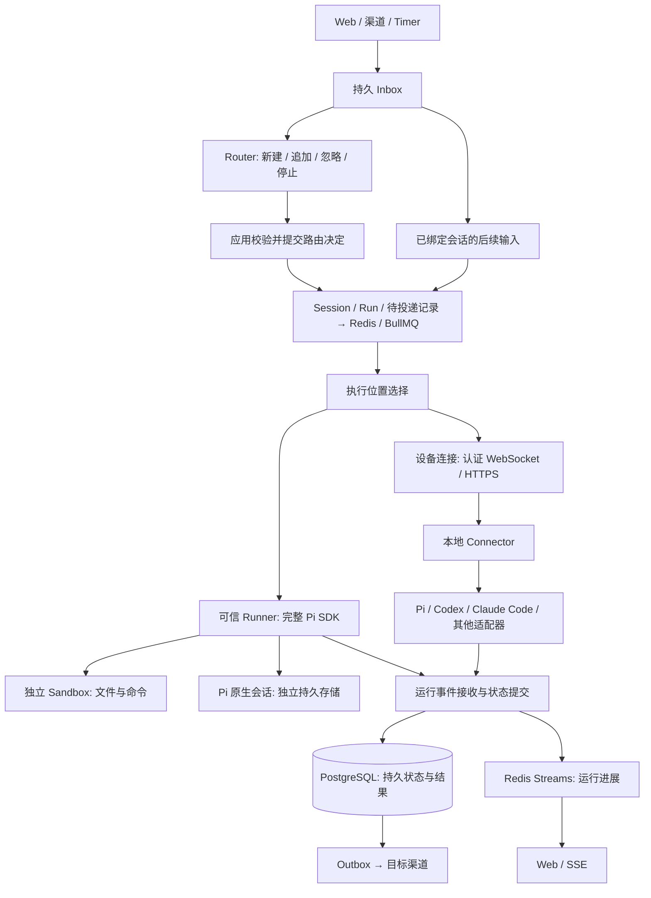

# ADR-0002：Agent 执行层与本地 Connector

日期：2026-11-14；2026-11-15 更新云端 SDK 选择、Sandbox 边界与实施顺序。

状态：云端决策 Accepted，首版 Pi 1.5.2 + E2B 已实现并验证；本地 Connector 部分仍为 Proposed。实际交付与恢复边界见 [云端 Agent](../cloud-agent.md)。

最新收敛版见 [架构总览](../architecture.md)。当前先验证云端完整 Pi SDK，Runner 与用户代码 Sandbox 分离；本地 CLI 接入后续推进。下面较细的职责拆分不要求逐项建目录或服务，沙箱具体后端依据 [源码与行业对照](../research/sandbox-design.md) 验证。

## 需求

通用 Always-on Agent 产品沿用 Inbox、Timers、Memory、Permissions、Outbox。用户希望通过 CLI 把多种本地 Agent 接入统一工作台，包含 Codex 等，而非仅接入一种 Agent。

用户要求能够持续跟随 Pi 版本升级。Pi 集成必须使用公开扩展方式，把升级相关知识集中在适配器，避免长期维护 Pi 分叉或将 SDK 状态扩散到产品模块。

需要在重复投递、Worker 重启、设备断线、审批等待和取消过程中保持可解释的状态。具体容量、操作系统支持范围和可用性目标尚未确定。静态源码证据见 [Pi 与本地 Agent 研究](../research/pi-and-local-agent-executors.md)。

## 建议决策

1. 平台负责来源、持久事件、Session/Run、Timer、记忆、授权和结果投递。
2. 云端通用执行器优先验证完整 Pi Coding Agent SDK，复用循环、原生会话与压缩。Runner 位于平台可信计算环境，用户代码通过公开工具后端在独立 Sandbox 执行，Pi 会话在沙箱外持久保存。
3. 独立 Connector CLI 在用户设备主动连接平台，管理设备上的多种 Agent。
4. 执行引擎与执行位置分开记录。执行器协议转换集中在各适配器，平台使用稳定、带版本的命令和事件契约。
5. Router 与 Worker 是执行角色，使用同一执行器接入约定；Router 的任务归属判断与执行器/位置选择分别维护，详见 [ADR-0003](0003-request-routing-and-dispatch.md)。

## 组件关系



## 执行引擎和执行位置

引擎说明谁组织模型、工具和会话，例如平台的 Pi SDK、Codex 或 Claude Code。位置说明在哪台设备或受管理环境执行；云端 harness 的部署位置与工具 Sandbox 分别记录，不能默认两者同处一个环境。

这两个维度分别记录。Agent 配置包含可用引擎和位置约束；每个 Run 固定当次选择及配置版本。将来切换引擎不修改既有 Run 的历史身份。

平台 Session 保存用户可见消息、执行关联和同步结果。外部运行时的 session/thread 引用按引擎、位置和工作目录绑定；它们自己的会话文件仍由对应运行时维护。平台持久化不意味着把所有本地会话文件自动上传。

原会话无法恢复时，明确选择失败、等待原设备恢复，或经规则允许创建新会话并注入已保存的上下文。新会话须记录新身份与来源，不能伪装成原执行已恢复。

## Pi 选型与替代方案

| 方案 | 收益 | 代价与当前判断 |
| --- | --- | --- |
| 自己基于模型 SDK 实现循环 | 完全控制调用顺序、消息与工具行为 | 自行维护较多已存在的循环逻辑；作为出现明确能力缺口时的替代方案 |
| Pi Agent Core + pi-ai | 复用通用循环和供应商接入；应用保持持久化和工具控制 | 会增加自有恢复、压缩等实现，作为完整 SDK 无法满足实际需求时的备选 |
| Pi Coding Agent SDK/RPC | 已有技能、扩展、压缩、工具和会话体验 | 当前优先验证进程内 SDK；需显式配置会话与资源，工具委派独立 Sandbox。RPC 留给实际需要隔离子进程或本地接入的场景 |
| pi-durable | 已有持久检查点、等待与工具恢复 | 实验性，现有单写者和内置存储约束需要适配 PostgreSQL/多 Worker；继续观察 |

若选择 Agent Core，平台内该执行器使用 pi-ai，不默认另叠一套模型 SDK。Pi 自身事件和类型由适配器解释，不扩散到 Web、渠道、存储和其他执行器。

## 跟随 Pi 升级的约定

此处的目标是升级工作集中、兼容性可验证，不承诺上游任何版本都无需改代码。所读 Pi changelog 已有工具 schema、回合钩子和公开导出调整，必须核对行为而不仅是类型。

### 依赖与 Interface

- 使用上游发布包及公开 exports，优先使用文档明确的扩展点。保持上游实现完整，不复制循环、不 monkey patch、不继承私有实现或深入导入源码。
- 若关键恢复或审批行为无法通过所用公开能力实现，重新评估官方 SDK/RPC 或调整平台执行政策，不以修改 Pi 内部实现来完成集成。
- 依赖集中在 `packages/agent-runtime` 对应 Adapter 的 Implementation。应用调用者只了解执行输入、资源生命周期、事件、交互和最终结果；不获取 Pi Agent 实例，也不按 Pi 的字段组织调用顺序。
- Interface 按当前已验证的执行需要设计，不逐一包装 Pi 的所有方法，也不把能力压缩到只能输出文本。首版只接云端 SDK，不为假想的第二种执行器建立通用框架；实际共同行为出现后再集中维护。
- 组合根可选择 Pi Adapter 并提供连接、凭据与工具能力；Pi SDK 的构造、协议解释、钩子映射和失败语义归 Adapter。
- 部署锁定一组经过验证的 Pi 依赖版本；依照上游依赖关系一起更新 core、pi-ai 和必要的 schema 包。通过明确的升级变更更新锁文件，不在运行中解析浮动 latest。

### 持久状态与恢复载荷

平台的 Inbox、任务归属、Session/Run 状态、审批、消息投影和 Outbox 使用自有版本化契约。需要恢复的引擎特有内容，如供应商返回的签名、调用引用或上下文信息，保留在由 Adapter 独占解释的版本化载荷中，不能为统一格式而丢弃。

恢复封套至少记录引擎、运行时版本、Adapter 格式版本及载荷引用。SDK 版本与存储格式版本分别管理；不是每次依赖升级都触发数据迁移。确有格式或语义变化时，由对应 Adapter 提供显式转换与历史样本验证，无法兼容时保留可诊断状态，不自动重放未知副作用。

Pi Core 的恢复钩子与消息顺序仍有语义耦合。这部分必须承认并集中维护，不能以“有 Adapter”为理由宣称零耦合。

升级 Agent Core 只获得该包及其依赖提供的改进，不自动获得完整 Coding Agent 的新扩展、压缩和 CLI 交互功能。需要完整 Pi 体验时，通过 Coding Agent SDK/RPC 执行器跟随相应版本升级，不能承诺平台自己实现的功能随 Pi 自动同步。

### 升级验证与发布

1. 阅读所用包的发布说明，对照公开导出和钩子/事件/取消语义调整 Adapter。
2. 类型检查后，在 `tests/sdk/` 用真实新版本 SDK 和可控模型响应验证事件时序、工具前后钩子及取消；Adapter 的公共行为测试和跨应用链路测试各放在其职责位置。
3. 使用上一支持版本产生的恢复样本，验证工具结果重用、未知副作用、待审批调用、上下文恢复及多工具顺序。RPC 还需验证接受响应与真正完成事件的区别。
4. 新 Run 使用新版本。已经运行的进程完成或在明确检查点结束后再更换版本，不在活动循环中热换 SDK。等待审批等持久状态同样经过恢复格式验证。
5. 小范围发布，观察错误、取消和恢复；回滚同时考虑是否写入了旧版不能读取的数据，不能只回退依赖版本号。

本地用户安装的 Pi CLI 与云端嵌入 SDK 独立升级。Connector 探测真实版本与能力；超出已验证协议范围时报告兼容性状态，不把新版本的未知字段或事件当作执行成功，也不长期保留多套旧实现分支。

以升级修改是否集中在 Pi Adapter、其版本化恢复格式与必要的公开契约变更来验收。如果每次都需修改 Inbox、Timer、渠道和页面业务流程，应重新检查 Interface 的知识泄漏。

## Executor 的公共责任

执行器接收本次需要的输入、上下文引用、工具能力、取消信号和事件接收能力，返回明确的执行资源与最终结果。资源所有者集中处理启动、持续读取、取消和释放，不能让调用者拼接隐含顺序。

稳定公共行为包括启动、消费事件、读取恢复引用、请求取消与收尾；审批回复、steering、follow-up、原会话恢复等按已验证能力暴露。具体协议字段、模型消息及进程状态保留在适配器。

能力声明至少区分恢复方式、输入方式、审批方式、取消方式及用量报告。无法提供的能力在配置和界面中明确表达；未知用量不记为零。能力由探测到的安装版本及适配器共同确定。

统一事件投影保留消息、工具、交互请求、运行状态、用量与恢复引用。各事件包含平台 Run、执行 attempt、生产者序号与相应消息/调用身份；平台状态版本和 Redis Stream 游标分开。第三方原始载荷只在需要诊断时按范围和保留策略存储。

## Connector 的责任

- 配对设备身份，报告执行器安装情况、版本、已验证能力及可用工作目录。
- 主动建立经认证的连接，接收结构化执行命令，检查设备和目录授权。
- 启动和管理对应子进程或 SDK session，将运行事件按序回传。
- 登记本地执行身份，处理重连核对、取消和进程释放。
- 若要求跨 Connector 重启补传，则用本地发送日志保存未确认事件，按服务端提交确认游标清理；该日志不是平台 Run 的另一份可独立修改真相。

Connector 通过服务端 API 和设备连接通信。Redis 连接与队列内部格式留在服务端。认证令牌按设备和执行范围签发，产品数据库不收集本地 Agent 的登录凭据。

## 调度、接收与完成

PostgreSQL 事务保存 Inbox/Run 和待投递记录；投递器发送 BullMQ 任务。Worker 领取后决定云端执行或向设备派发。

设备派发采用执行 attempt 和递增所有权版本。重复命令先核对已有本地执行，防止同一次 attempt 重复启动。启动 ACK、开始执行、等待交互和最终结果分别记录；派发的队列任务完成不代表 Run 已完成，也不让一个 BullMQ job 一直等待数日审批。

事件接收按身份去重并校验当前所有权。关键状态与最终消息提交到 PostgreSQL，再发布或补偿发布对应事件；高频输出走 Redis Streams。恢复时从持久状态核对并补发缺失通知。Redis 数据丢失或游标过期后从消息快照重新同步。

同一 Session 的写入遵守执行所有权。设备失联时不能仅因租约超时就假定旧进程已经停止，也不能自动把具有副作用的同一次工作派到另一台设备重复执行。先核对原执行，或进入需要决策的未知状态。

设备离线时保留任务等待条件；平台仍能接收来源事件、维护 Timer 和展示记录。用户电脑休眠期间，本地 Agent 不具备持续执行能力。

## 权限、审批与取消

平台工具的执行授权在调用前实施。第三方 Agent 的内部工具权限由其可桥接的审批协议与执行环境约束；统一展示事件本身不能拦截内部执行。

审批记录绑定 Run/attempt、调用身份、参数和授权范围。SDK/RPC 的临时 request ID 只在对应进程仍存在且请求有效时使用；进程重启后必须核对或重新发起交互，不能向新进程重放过期回复。

平台自有执行器可保存待审批调用并释放本次执行资源，批准后恢复。第三方运行时是否能释放进程后继续，需要逐个验证，不承诺全部支持。未经确认的审批不能默认为允许。

取消先保存请求，再发协议取消；必要时按引擎约定终止进程组，并等待确认。未确认终止时保留取消中或结果未知状态；页面断开只取消订阅，不取消 Agent。

## 建议目录增量

```text
apps/
  server/src/
    agents/                     # 配置、记忆和工具授权
    sessions/                   # 输入、会话、消息与流订阅
    tasks/                      # Router、Run、调度与执行所有权
    sandbox/                    # 工具环境、provider 与生命周期
    devices/                    # 后续本地设备归属、能力与派发
  cli/src/
    connect/                    # 后续本地连接、配对与派发
    run/                        # 真实 CLI 执行、回传与关停
packages/
  contracts/                    # HTTP、设备命令与事件 schema
  agent-runtime/
    src/
      pi/                       # 当前云端 SDK 的具体集成
```

目录按实际能力实施时创建，不为候选执行器预建目录。Connector 和云端确实复用的 SDK/进程适配器放入共享包；服务端数据库、租户配置和业务工具清单留在其所有者。无状态转换使用函数，有关联状态和生命周期的执行资源可以用 class 或闭包表达，遵守 [TypeScript 代码规范](../typescript-style-guide.md)。

## 建议实施顺序与验收

先做云端完整 Pi SDK 的通用工具链路，一期只验证 DeepSeek 真实调用、独立 Sandbox、原生会话持久化、流、取消及故障恢复；多供应商接口沿用 Pi，不接入或调用 Claude。本地阶段再验证 Connector 派发一个真实 Agent 并完整回传结果，以实际行为检验需要共享的契约。

后续本地接入候选为 Pi RPC、Codex App Server、Claude Code，以及一个用于验证协议共性的 ACP 执行器；清单是后续实施建议，不代表已实现支持。平台已有 Agent 仍可使用同一套 Inbox、Timer、审批与展示，具体工具和引擎按场景配置。

验证内容：

1. 重复投递与设备重连不重复启动同一 attempt。
2. 模型完成、工具执行前后杀进程，区分完成、可重放与未知副作用。
3. 并行工具批次中出现审批，不把待审批调用记录成普通失败后遗失。
4. 原运行时会话存在/丢失时，分别验证真实恢复与新会话衔接。
5. 设备断线、事件 ACK 丢失、Connector 重启和流游标过期。
6. 取消在启动前、执行中、等待交互时到达，核对资源最终释放。
7. 不同用户、设备、目录及 attempt 的消息和交互隔离。
8. 普通文本及工具进度、最终产物、未知用量在 Web 中如实展示。

本 ADR 未给出性能结论，也未声称 Pi 或全部外部 Agent 已满足上述恢复与审批要求。执行层最终选择以这些链路验证和用户评审为准。


## 首版实现边界（2026-11-15）

平台持久化执行器检查点 JSON，具体格式只由执行器解释；Pi 原生文件留在可信持久卷。共享执行观测与工作环境能力不复制 Pi SDK，不要求未来本地执行器使用文件路径。组合根直接选用 Pi 和 E2B，不增加尚无第二实现的注册表。

首版每条输入排入独立 Run，同 Session 串行；中断与未知副作用隔离，不自动重放。CLI 接入、交互审批、Router 和完整删除/回收流程不在本轮实现中。真实测试仅调用 DeepSeek，第二 provider 仅受控响应验证。
