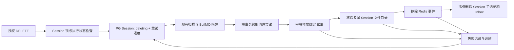

# ADR-0003：Agent 与 Session 生命周期

日期：2026-11-16。状态：已采用。

## 背景与要求

已有私有 Session、PG 执行租约、原生 Pi 历史和按需 E2B。现在增加 Agent 编辑/停用、会话命名/归档/删除与可重试回收，继续只做后端。约束是保留当前权限和配置快照，避免删除活动执行、别人的对话或未知副作用证据；进程退出、Redis 丢失及重复投递后仍能完成已接受的删除。

## 决定

Agent 状态为 active / disabled。创建者可以管理自己的定义，Owner/Admin 还可管理 Workspace 可见定义；私人定义不开放管理越权。指令、模型和推理强度更新只影响新建 Session；已有 Session 使用自己的配置，Run 保留准入快照。停用阻止新准入，排队领取和运行中的授权检查观察停用并取消；它遵循现有合作取消时序，不承诺立即终止外部效果。空 Agent 可以直接删除，有任何 Session 时返回冲突，先完成会话回收。

Session 的公开状态为 active / archived，内部另有不可恢复的 deleting。归档只改变列表分类，不取消既有 Run；新输入原子恢复 active。列表默认 active，可显式查询 archived。命名、归档和删除需要当前 Workspace 写权限与本人会话归属，且不依赖 Agent 是否仍可执行，因此停用后仍能管理和取消自己的会话。Viewer 继续只读。

DELETE 在原 Session 锁下检查 queued / running / cancelling / recovery_required，没有阻断项才持久写入删除请求并返回 202。重复请求返回原进度。deleting 立即退出普通列表、历史、SSE 和执行入口；进度通过独立读取接口查询。归档可恢复，删除请求不能撤销。

沿用现有 Worker 和连接；删除只带 Session ID。PG 保存下一次尝试时间、尝试数与稳定错误码，短领取期限过后可重新扫描。重复清理针对同一不可复用的身份，E2B 已不存在、文件目录已不存在都视作已完成；最终提交也允许重复。远端 I/O 期间不持有数据库事务。队列去重只减少重复工作，不承担删除正确性。

文件布局由 Session 存储模块集中维护，删除确定的 Session 专属目录，覆盖全部 Run/attempt；不从不透明检查点提取任意路径。先确认沙箱释放再删除会话文件，清理失败时仍保留数据库归属。Worker 关闭先等待资源操作，再进入有期限的队列传输收尾；正常退出等待最终提交，传输失败时报告错误并保留待重试意图。

## 取舍与替代方案

- 同步 HTTP 删除：请求断开或进程退出可能留下半完成状态，采用持久删除意图。
- 先删 PG 再清理：丢失资源归属和重试依据，采用资源确认后最终提交。
- 单纯软删除：适合回收站需求，但不能完成资源回收；本期提供归档及不可撤销的异步删除。
- 通用回收站/工作流服务：目前只有一种云端会话资源组合，使用明确的 Session 删除流程；没有新的服务或调度框架。
- 每一步单独记录成功标记：当前外部删除均可重复，完整重试更简单。未知业务工具效果继续进入 recovery_required 并阻断删除，不将工具执行套入幂等回收规则。

代价是每个会话增加少量生命周期字段，清理故障期间保留其行和资源；需要 Worker、同一会话卷与 E2B 连接可用。重复清理不等于业务副作用 exactly-once。旧检查点在会话存续期间的容量淘汰、跨机器存储迁移和待核对业务效果的自动对账仍属后续工作。

## 依据与验证

官方来源、LobeHub 固定版本代码范围及差异见 [生命周期调研](../research/agent-session-lifecycle.md)。验证覆盖权限、合并后模型配置、历史配置不漂移、归档恢复、删除与准入竞态、忙碌和待恢复阻断、重复请求、外部失败/进程中断后重试、文件路径隔离，以及真实 E2B 已暂停/已不存在的删除。
