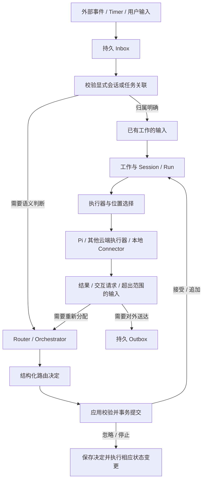

# ADR-0003：请求 Router、工作执行与派发

日期：2026-11-14。

状态：Proposed。根据用户对 DeepSeek Router 的提醒补充语义路由，尚未实现或运行验证。Pi 应可随上游升级的约束已纳入 [ADR-0002](0002-agent-execution-and-local-connector.md)。

## 需求

产品持续接收对话、Webhook、Timer 和执行反馈。系统既要知道事件归属哪项工作，也要知道由哪个执行器、在哪个位置执行。前一版图只画了后两者，没有明确表达请求归属和主动接单判断。

基础设施沿用已确定的 PostgreSQL、Redis + BullMQ、Redis Streams。Router 使用自有任务与会话契约，不依赖 Pi 的内部消息或 Agent 实例。

## DeepSeek 公开原型的证据

固定提交 `8c32a9dc5d72c033816c6a8110b37f40cf94fba4`：

- `src/app/sessions.ts` 定义 `ROUTER_PRESET = 'dsh-superagent-router'` 和 Worker preset，创建 Session 时按 `orchestrator` / `worker` 角色选择。两种角色的初始模型配置分别取 `settings.eval.model` 与 `settings.executor.model`，可以独立配置，不要求必须是不同模型。
- `cordis.patch.yml` 中 Router 的工具范围较小，禁止文件写入等执行功能；`prompts/orchestrator.md` 让其评估和路由请求，由 Workers 调查与实施。
- `orchestrator_route` 的四种动作是 `accept`、`attach`、`ignore`、`stop`。其中 `attach` 要指向已有 Ticket；相似主题本身不足以证明应归并。
- 显式请求由主 Session 路由；主动推断的接单还经过 `orchestrator_eval*` 与当前规则核验。`MasterAssessor` 提供有界上下文，并把模型结果交回 Engine。
- `Engine.decide` / `attach` 等命令负责事务和政策约束；例如政策版本变化时重新评估或记录不可用，模型不能自行授予执行权限。
- 已经订阅到 Ticket 的人类后续消息通常直接交给其 Worker 判断。超出任务范围时 Worker handback，再进入 Router；并非每条输入都重新让 Router 推理。

这里的 Router 路由工作与上下文归属。公开原型的 Executor 是 DshExecutor，不是一个已经实现了 Pi、Codex 等多引擎自动选择的平台。本文将语义路由与多执行器接入组合，是本产品的设计建议。

## 建议决策与职责

| 职责 | 需要知道的事实 | 产出 |
| --- | --- | --- |
| 请求 Router | 原始事件、已有工作摘要、会话关联、用户意图、允许的候选与规则 | 新建工作、追加到已有工作、忽略、停止等结构化决定及来源依据 |
| 应用校验与提交 | 当前权限、归属、任务状态、输入/政策版本与幂等身份 | 接受、拒绝或要求重新判断；事务内保存决定与待执行动作 |
| 执行器与位置选择 | 已确认的任务需求、用户指定、引擎能力、设备与凭据可用性 | 本次执行绑定的引擎、版本、位置及恢复方式 |
| Executor Adapter | 本次执行输入、工具能力、执行器协议和生命周期 | 事件、结果、交互请求、取消确认与恢复引用 |

这些职责可以在同一个服务和少数内聚模块中实现，不需要为每一项独立建微服务或另写一套调度框架。Router 是角色与一组允许的动作，可使用已经选定的模型/Agent 执行器；任务归属规则与最终提交归应用所有。

## 处理主线

归属明确的输入仍需校验权限、当前状态和所有权，不因跳过模型而跳过规则。明确指定的引擎与设备可以按确定规则选择；未指定时才需要根据能力与用户策略选择。Router 不持续等待 Worker，完成决定后释放本次执行资源。

## Router 的输入、决定和状态

Router 读取事件的原始引用和有限摘要、有关联的工作、最近决定、用户配置与允许的候选。需要更多上下文时经具名读取能力取得；不默认加载所有 Worker 转录。

决定保存输入事件 ID、目标工作/会话、动作、用户可理解的理由、所依据的状态与政策版本。路由说明只记录归属事实和明确约束，保留原请求，不把简短请求改写成 Router 自己的实施方案。

语义判断在数据库事务外完成。提交时重新读取并校验相关事实，条件更新并事务写入决定、业务状态及待投递记录；过期决定重新判断或明确拒绝。使用事件批次和当前归属身份防止重试重复创建工作。

模型输出是候选决定。权限、跨用户资源、停止/恢复约束、已被其他 Worker 领取的输入和重复接单由应用核验。Router 无法通过选择另一个执行器扩大权限。

## Worker 与 Router 的协作

Worker 负责已分配工作的调查、工具执行和具体结果。关联到已有工作的后续输入优先交给它；超出任务范围的输入可以交回 Router，附原始事件引用与归属原因。

结果与需要用户决定的问题按规则进入 Outbox。普通执行进度进入工作台；不为了实现 Router 而把每个进度事件再送一次模型。停止、等待和结果送达状态持久化，避免后续报告重复唤醒或重复通知。

通用产品可使用自己的工作实体承载长期归属，Session 承载上下文，Run 承载执行。DeepSeek 的 GitHub Ticket、PR、工作目录和 Mandate 细节不直接复制为所有场景的前提。

## 与 Pi 解耦及升级

Router 和 Worker 使用相同的执行器 Interface，拥有不同提示词、工具和模型配置；角色本身不要求特定 SDK。对所用公开钩子的理解、Pi 事件转换、模型特有上下文与恢复载荷归 Pi Adapter。

Pi 升级后可以在对应 Adapter 内调整事件或钩子映射，不修改路由决定的业务语义。若上游变化影响已保存的恢复数据，执行显式格式迁移并验证旧样本；不能承诺更换版本号就兼容。

## 取舍与验证

Router 增加一次可能的模型调用、判断延迟和误归并风险；明确归属直接投递、有界上下文和独立工具范围可以减少成本与干扰。第一版只实现实际需要的动作，不先构造通用工作流 DSL。

验证显式任务直达、未知请求新建、明确引用追加、相似主题不误归并、Worker handback、不重复通知、政策变更后的过期决定、用户停止后不被自动恢复，以及 Router 调用 Pi Adapter 升级前后的相同行为。

静态证据证明原型有 Router 角色和路由流程，不代表已经验证本产品的路由准确率、容量或多执行器协同效果。

## 来源

- [DeepSeek Sessions](https://github.com/deepseek-ai/dsh-superagent-prototype/blob/8c32a9dc5d72c033816c6a8110b37f40cf94fba4/src/app/sessions.ts)
- [Router preset](https://github.com/deepseek-ai/dsh-superagent-prototype/blob/8c32a9dc5d72c033816c6a8110b37f40cf94fba4/cordis.patch.yml)
- [Orchestrator 提示词](https://github.com/deepseek-ai/dsh-superagent-prototype/blob/8c32a9dc5d72c033816c6a8110b37f40cf94fba4/prompts/orchestrator.md)
- [路由规则](https://github.com/deepseek-ai/dsh-superagent-prototype/blob/8c32a9dc5d72c033816c6a8110b37f40cf94fba4/prompts/dispatch.md)
- [orchestrator_route 工具](https://github.com/deepseek-ai/dsh-superagent-prototype/blob/8c32a9dc5d72c033816c6a8110b37f40cf94fba4/src/app/tools/main.ts)
- [Engine 与事务入口](https://github.com/deepseek-ai/dsh-superagent-prototype/blob/8c32a9dc5d72c033816c6a8110b37f40cf94fba4/src/core/engine.ts)
- [Eval 决定与政策核验](https://github.com/deepseek-ai/dsh-superagent-prototype/blob/8c32a9dc5d72c033816c6a8110b37f40cf94fba4/src/core/evals.ts)
- [公开原型的实现架构](https://github.com/deepseek-ai/dsh-superagent-prototype/blob/8c32a9dc5d72c033816c6a8110b37f40cf94fba4/docs/007-architecture.md)
- [Pi Agent Core 版本变化](https://github.com/earendil-works/pi/blob/c815ddaa3736bd0b009ce6a997ee5003f8a3a532/packages/agent/CHANGELOG.md)
