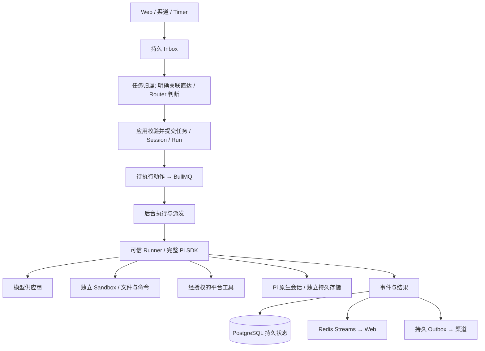

# 通用 Always-on Agent 架构总览

日期：2026-11-15。

状态：云端首条后端链路已经实现并通过真实 DeepSeek + E2B 验证。PostgreSQL 保存持久事实，Redis + BullMQ 唤醒执行，Redis Streams/SSE 交付短期进度；完整 Pi SDK、可信 Runner、用户代码 E2B Sandbox 和原生会话存储分别管理。详细接口、恢复限制和测试见 [云端 Agent 后端](cloud-agent.md)。

工程骨架、用户认证、Workspace/RBAC 与云端 Agent 执行已落地，无新增业务前端。本文同时保留 Router、Timers、Memory、Outbox 等后续职责，未实现部分在下文明确标记；不能将目标架构视为已交付能力。

## 一个后台，两种 Agent 角色

产品由 Web、后端、CLI 三个交付物组成。当前先实现平台自有云端 Agent；本地 CLI 接入后续再做。后端使用同一代码库，分别启动 API 和后台 Worker。Router 与任务 Worker 是 Agent 角色，Runner 是承载 Pi 会话的执行资源，Sandbox 是独立的代码执行环境；这些职责不分别建立微服务或通用调度框架。



Runner 和用户代码不共享执行环境；Pi 原生会话也不放进用户 Sandbox。Runner 自身可以容器化部署，仍属于平台可信计算环境。这个划分遵循 Anthropic 的 [Harness、Sandbox、Session 分离设计](https://www.anthropic.com/research/managed-agents)，不表示我们已经获得其托管服务的故障恢复保证。

## 产品对象

| 对象 | 职责 |
| --- | --- |
| Agent | 可复用的指令、模型选择、工具、记忆范围和授权配置，归属 Workspace |
| Task | 一项需要跨轮次跟踪的工作及其进度；普通聊天不强制创建长期任务 |
| Session | 一段持续对话和执行上下文，关联 Pi 原生会话 |
| Run | 一次被输入唤醒后的有限执行，记录输入、配置、状态、用量与结果 |
| Sandbox | 任务工具访问的文件与命令环境，有独立的身份和生命周期 |

Agent 配置可以被多个 Session 使用，一个 Session 可以经历多个 Run。同一 Session 同时只有一个有效写者；其他 Session 可以并行执行。Workspace 是人的协作空间，不能与 Sandbox 的工作目录混为一谈。

## 输入、执行与提交

输入先进入 PG Inbox，来源身份用于去重；输入与待唤醒动作在同一事务提交，再由投递器发送 BullMQ。队列重复投递时依据持久输入和 Run 核对，不能再次创建同一份工作。后台领取时检查当前权限；首版每条输入创建一个 Run，按 Session 顺序执行，不批量合并输入。

明确关联到已有 Session 的输入直接交给任务 Worker；需要归属判断时才调用 Router。路由推理在事务外完成，应用在提交时重新核对资源、权限、状态与幂等身份。调用 Pi 前绑定本次模型和工具配置、原生会话引用以及需要的 Sandbox；仅在实际需要文件或命令环境时准备 Sandbox。

运行中的新输入仍先持久化，排入后续 Run；首版不接中途 steering/follow-up。Pi 的内存输入队列不替代持久 Inbox。执行结束并释放 SDK、暂停沙箱后，平台以 owner token 和有效租约提交最终状态与原生检查点。渠道结果投递留待 Outbox 实现。长期在线体现为持续可唤醒，不要求每个 Agent 常驻一个进程。

## Claude 的五个部件与后续范围

| 部件 | 落点与进度 |
| --- | --- |
| Inbox | PG 保存输入、稳定身份、归属和处理状态；Redis 队列负责唤醒 |
| Timers | 后续：PG 保存计划与到期状态；后台扫描转成 Inbox 事件 |
| Memory | 当前保存 Agent 指令与原生会话；跨会话笔记、进度整理和已通知记录后续实现 |
| Permissions | 已有当前成员/资源/工具授权；持久审批交互后续实现 |
| Outbox | 后续：PG 保存待发送内容及回执，后台投递与重试 |

它们是职责与持久记录，不能因合并目录而丢失，也不要求一个部件对应一个服务。

这五项来自 [Building always-on agents](https://claude.com/resources/articles/building-always-on-agents)。本产品按这些职责逐步增加持久状态，通过明确工具按需访问；原始会话、当前上下文和跨会话记忆分别维护。初版不增加向量数据库或独立的记忆整理框架。

## DSH 的 Router / Worker（后续）

Router 根据原始输入、已有工作摘要和允许的候选，判断新建、追加、忽略或停止。Worker 调查和执行具体工作。明确归属的后续输入直接送已有 Worker，超出范围时再交回 Router。

Router 完成一次判断就结束本次执行，不持续等待 Worker。它使用较小的工具范围，模型可独立配置；模型决定由应用校验并原子提交。Router 与 Worker 可以复用同一 Pi 集成，不额外造一套 Agent 系统。

采用 DSH 的状态和待执行动作同事务提交思想；队列投递之后允许重复唤醒，消费时按持久身份和执行所有权判断，不整段盲目重跑副作用。

## 执行与 Pi 升级

平台使用少量明确的执行输入、事件、交互和结果契约。Pi SDK/RPC、其他 CLI 协议和资源释放集中在运行实现里。使用上游公开包与扩展点，不修改 Pi 循环。升级时集中适配、验证历史恢复样本和取消/工具时序；运行中不热换 SDK。

当前已接入 [完整 Pi SDK](https://docs.pi.dev/latest/sdk) 的 `@earendil-works/pi-coding-agent`，使用 `createAgentSession()`、原生 SessionManager、公开工具与扩展。Pi 拥有模型/工具循环、原始上下文和压缩；平台不另外实现一套会话引擎。SDK 的指令和工具可配置，平台 Agent 不限于编程用途。

多模型沿用 Pi 的 provider 支持。公共契约保存通用模型引用 `{ provider, id }`，不包含厂商型号枚举或部署默认值。服务端根据 Pi 和已启用的模型连接提供可选目录，并在选择时校验可用性和权限；凭据独立管理。用户可以切换模型，后续 Run 使用新选择，已开始的 Run 保留实际配置快照。Router 与任务 Worker 可以分别选择模型。跨供应商会话继续需要实测，不承诺任意切换无损兼容。

平台只保存执行器可解释的 JSON 检查点；Pi 文件路径与格式由 Pi 适配器解释，未来本地执行器不需要模拟 Pi 会话文件。Pi 集成与版本解释集中在 `packages/agent-runtime`，业务工具清单和授权归对应 server 功能。只建立产品实际需要的入口，不复制 Pi 的整套 Interface 或事件类型；不修改私有方法、循环或原生会话格式。升级锁定正式发布版本并验证旧会话、工具、事件及取消行为。详细依据见 [云端执行研究](research/cloud-agent-runtime.md) 和 [ADR-0002](adr/0002-agent-execution-and-local-connector.md)。

## 本地与云端

当前云端路径是可信 Runner 运行 Pi SDK，read/write/edit/bash 通过公开工具 operations 委派给 Sandbox provider；未接入远端的工具不启用，不回退到平台本机。模型凭据、平台管理凭据和 Pi 会话目录不进入用户 Sandbox，也不将 Runner 环境变量整体传给远端命令。

需要文件的长期任务绑定明确的执行目录及环境身份，后续 Run 复用它。实例生命周期与任务状态分开。实际工作文件与依赖由执行环境的卷或快照保存，最终产物的对象存储接入后续实现；Pi 原生会话单独持久化，当前依赖 API/Worker 可共同访问的持久目录，尚无对象存储同步和旧检查点回收。PG 保存产品事实、输入、配置、消息投影与存储引用；不能只存一个引用就声称原始会话或工作文件已经可恢复。

后续本地 CLI 使用用户电脑的原生环境、已有 Agent 安装和本地会话，接入 Codex、Claude Code、Pi 等真实支持的协议。其执行器恢复与能力逐个验证；当前不预制 Connector 或多执行器框架，也不让本地接入改变云端 Pi 的部署边界。

云端沙箱使用用户指定的 E2B，直接复用官方 SDK；默认服务是平台预配置的 E2B 连接。本机 M5 已部署官方开源 Embed，通过独立 Colima/VZ 虚拟机里的 KVM 运行 Firecracker，无需云端账户。其他项目只保留为研究参照，不作为并行实现或默认替换后端，不自研虚拟化或快照平台。证据与能力差异见 [沙箱研究](research/sandbox-design.md)。

## 恢复、流与权限

| 情况 | 处理原则 |
| --- | --- |
| 浏览器断线或刷新 | 原 Run 继续；SSE 按游标补流，并以持久消息和状态对账 |
| Runner 进程重启 | 正常边界的原生检查点可由新 Worker 接续；中断的一轮租约过期进入 recovery_required，核对前不自动重跑 |
| Sandbox 失效 | 作为工具环境故障处理，保留会话；工作文件未恢复时不能用空目录继续冒充原环境 |
| 外部操作结果未知 | 保留 pending 意图并停止 Session，首版需人工核对；没有自动对账或任意副作用 exactly-once 保证 |

HTTP 接收消息与取消，Redis Streams 传运行进度，SSE 对外订阅。累计草稿替换与持久消息分别处理，游标超出保留范围时明确重新同步；订阅关闭不取消 Run。借鉴 LobeHub 的事件与持久结果对账，不移植其全部 Gateway 协议。最终消息和完成状态使用正确的 SDK 生命周期边界，不能只把底层 agent_end 当作整个 Run 已完成。

Workspace 角色通过 Better Auth 提供，具体 Agent/Session 资源访问与工具执行授权由业务维护。每次操作前检查实际权限；有权限使用某个 Agent，不等于自动批准它的所有外部动作。审批记录必须可持久恢复，批准回到 Inbox 后再次核对授权。是否直接恢复 SDK 的中途工具调用，或采用待批准业务操作再继续，由公开接口和故障原型确定，不用长期悬挂 Promise 冒充可恢复审批。

## 工程组织

详细目录、部署环境变量、产品设置、凭据与本机配置的归属见 [项目目录与配置管理](project-structure.md)。这里保留运行职责总览。

```text
apps/
  web/
  server/src/
    bootstrap/          # API / Worker 启动与依赖组装
    workspaces/         # 人类协作空间、成员、邀请与固定角色
    agents/             # 配置、记忆、工具授权
    sessions/           # 会话、消息、Inbox
    tasks/              # Router、任务与 Run、到期触发
    devices/            # 本地 CLI 设备身份、连接与派发
    channels/           # 来源接入、Outbox 与发送
    sandbox/            # 环境绑定、生命周期、provider
    infrastructure/     # 实际共用的连接、存储、认证与凭据实现
  cli/src/
    connect/            # 本地连接、设备身份与派发
    run/                # 共用执行入口、回传与关停
packages/
  agent-runtime/        # 实际共用的 Pi / 外部 Agent 适配
  contracts/            # API、设备命令与运行事件 schema
docs/
```

这是职责图，随实现创建，不预建所有目录。数据库事务代码随相应功能维护；队列和 SDK 的具体依赖在组装处绑定。每个功能通过明确入口提供能力，单元测试相邻；SDK 研究和完整链路测试分别放入 `tests/sdk`、`tests/integration`。

协作身份与团队 RBAC 已通过现有 Better Auth 的 organization 插件接入后端。工作空间角色、具体资源访问和 Agent 工具审批分别实施；完整范围与 SDK 故障边界见 [工作空间与授权方案](workspaces-and-authorization.md)。

第一版不再额外叠 application/domain/infrastructure 多套镜像目录、通用工作流 DSL、事件总线框架或每个角色独立进程。职责确实增长时，按状态归属与变化原因再拆分。

## 验证与后续顺序

已贯通一个云端 Session：输入持久化、完整 Pi SDK、DeepSeek 真实调用、一个真实工具及独立 Sandbox、流式输出、原生会话继续和取消。一期只调用 DeepSeek；多供应商能力沿用 Pi 的公开模型接口，不接入或调用 Claude。先覆盖非编码任务，避免将通用 Agent 验证缩成编程 CLI 演示。

已验证浏览器断线、重复领取、单写者、租约失效、未知结果隔离、真实沙箱丢失及 Worker 重启后的正常接续。尚未进行生产容量测试、任意时点进程强杀矩阵或跨版本迁移验证。随后再接 Router 与长期 Task、Timers、跨会话 Memory、审批和 Outbox。基础资源授权从第一条执行链路就生效。本地多 Agent Connector 后续独立推进。

投入重点是工具效果、上下文、路由准确率和任务评估。以实际任务成功率、误归并、重复动作、成本和延迟判断改进，不先增加调度层或记忆框架。
