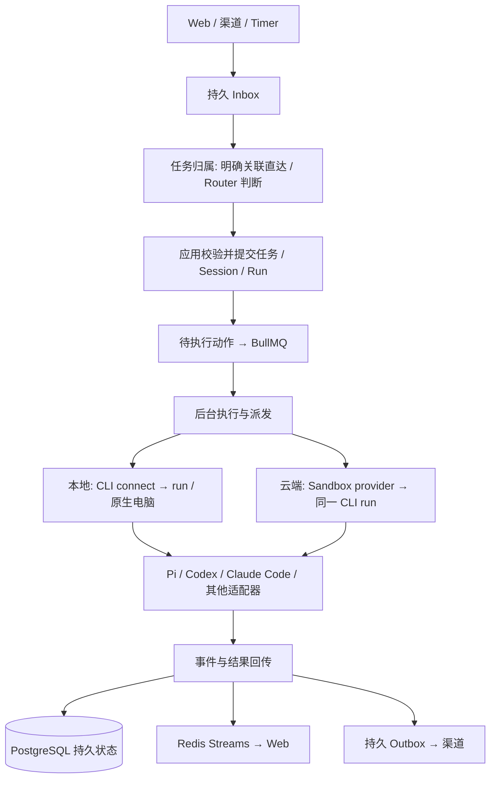

# 通用 Always-on Agent 架构总览

日期：2026-11-14。

状态：收敛后的架构建议。PostgreSQL、Redis + BullMQ、Redis Streams 已确认；Pi 的具体集成方式和默认云端沙箱后端尚待最小链路验证。本文作为当前设计总览，替代早期提案中偏细的目录与抽象拆分；研究与 ADR 保留取舍依据。

工程骨架和后端认证已搭建：Web 初始化页、API/Worker、CLI、两个共享包、环境解析、数据库迁移、三种登录后端和 CI 均已落地。实际能力、待开发范围与运行命令见 [README](../README.md)，认证行为见 [接入说明](authentication.md)。下文描述目标架构，不表示 Router、Agent 执行和沙箱已经实现。

## 一个后台，两种 Agent 角色，两种执行环境

产品由 Web、后端、CLI 三个交付物组成。后端使用同一代码库，分别启动 API 和 Worker。Router 和 Worker 是角色，沙箱是后端中的一个模块；不分别建立微服务或通用调度框架。



图中的 Engine 表示共用执行入口和事件契约，不表示不同用户或环境共享同一个 Agent 进程。

## Claude 的五个部件保持完整

| 部件 | 第一版落点 |
| --- | --- |
| Inbox | PG 保存输入、稳定身份、归属和处理状态；Redis 队列负责唤醒 |
| Timers | PG 保存计划与到期状态；后台扫描将到期转成 Inbox 事件 |
| Memory | PG 保存 Agent 指令、笔记、进度和已通知信息，执行时按需装入上下文 |
| Permissions | 应用与执行器在实际操作前检查权限；保存交互与批准状态 |
| Outbox | PG 保存待发送内容及回执，后台投递与重试 |

它们是职责与持久记录，不能因合并目录而丢失，也不要求一个部件对应一个服务。

## DSH 的 Router / Worker

Router 根据原始输入、已有工作摘要和允许的候选，判断新建、追加、忽略或停止。Worker 调查和执行具体工作。明确归属的后续输入直接送已有 Worker，超出范围时再交回 Router。

Router 完成一次判断就结束本次执行，不持续等待 Worker。它使用较小的工具范围，模型可独立配置；模型决定由应用校验并原子提交。Router 与 Worker 可以复用同一 Pi 集成，不额外造一套 Agent 系统。

采用 DSH 的状态和待执行动作同事务提交思想；队列投递之后允许重复唤醒，消费时按持久身份和执行所有权判断，不整段盲目重跑副作用。

## 执行与 Pi 升级

平台使用少量明确的执行输入、事件、交互和结果契约。Pi SDK/RPC、其他 CLI 协议和资源释放集中在运行实现里。使用上游公开包与扩展点，不修改 Pi 循环。升级时集中适配、验证历史恢复样本和取消/工具时序；运行中不热换 SDK。

Pi Core 与完整 Coding Agent SDK/RPC 的最终组合通过最小链路确定。优先复用所选包已有的会话、压缩和工具能力；确需自己维护的持久状态及规则有明确所有者，避免把 Pi 的功能重做后再称为可自动随上游升级。详细规则见 [ADR-0002](adr/0002-agent-execution-and-local-connector.md)。

## 本地与云端

本地 CLI 使用用户电脑的原生环境、已有 Agent 安装和本地会话。云端通过 provider 准备环境并启动同一个 CLI run；用户代码和第三方 Agent 不在 API 进程里执行。两条路径统一回传事件与结果，本地 connect 的连接管理不复制一套业务流程。

一个长期任务默认绑定独立工作空间，后续 Run 复用它。运行实例按需取得和释放，实例生命周期与任务状态分开。实际文件、依赖和运行时会话文件依赖卷或快照，最终产物进入对象存储；PG 保存产品事实和环境引用。

默认沙箱由平台预配置，额外服务通过同一个 provider 入口接入。E2B 为托管候选，OpenSandbox 为可自托管默认服务的优先评估候选，Onlyboxes 是已有 LobeHub 对接证据的参照。首轮只落实一个默认后端和所需外部接入，不自研虚拟化或快照平台。证据与能力差异见 [沙箱研究](research/sandbox-design.md)。

## 工程组织

详细目录、部署环境变量、产品设置、凭据与本机配置的归属见 [项目目录与配置管理](project-structure.md)。这里保留运行职责总览。

```text
apps/
  web/
  server/src/
    bootstrap/          # API / Worker 启动与依赖组装
    agents/             # 配置、记忆、工具授权
    sessions/           # 会话、消息、Inbox
    tasks/              # Router、任务与 Run、到期触发
    devices/            # 本地 CLI 设备身份、连接与派发
    channels/           # 来源接入、Outbox 与发送
    sandbox/            # 环境绑定、生命周期、provider
    infrastructure/     # 实际共用的连接、存储、认证与凭据实现
  cli/src/
    connect/            # 本地连接、设备身份与派发
    run/                # 共用执行入口、回传与关停
packages/
  agent-runtime/        # 实际共用的 Pi / 外部 Agent 适配
  contracts/            # API、设备命令与运行事件 schema
docs/
```

这是职责图，随实现创建，不预建所有目录。数据库事务代码随相应功能维护；队列和 SDK 的具体依赖在组装处绑定。每个功能通过明确入口提供能力，单元测试相邻；SDK 研究和完整链路测试分别放入 `tests/sdk`、`tests/integration`。

第一版不再额外叠 application/domain/infrastructure 多套镜像目录、通用工作流 DSL、事件总线框架或每个角色独立进程。职责确实增长时，按状态归属与变化原因再拆分。

## 验证顺序

先贯通一个新请求经 Router、Worker 和工具执行到持久结果，再用同一 CLI run 分别验证原生本地与云端沙箱。补上明确后续输入、Timer、审批、Outbox、Pi 升级、设备重连和实例停止/恢复。以故障行为验证恢复规则，不以类型检查通过代替运行验证。
