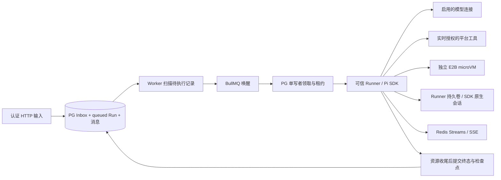

# 云端 Agent 后端

日期：2026-11-15。已实现首条后端链路，无新增前端。真实模型验证仅使用 DeepSeek；第二供应商使用本地受控响应验证配置和 SDK 适配，不表示实际调用过该供应商。

## 执行路径



`Agent` 保存可复用指令、默认模型、推理强度与可见性。`Session` 保存持续会话、下一次 Run 的配置、执行器检查点和绑定沙箱。`Run` 保存一次输入的配置快照与执行状态。同一 Session 按输入顺序执行，一个 Run 的模型循环完成后再开始下一个；当前没有中途 steering 或 follow-up 投递。

API 和 Worker 使用同一代码库，独立进程。Runner 是 Worker 内可信执行职责，目前不另起 Runner 服务。Pi 管模型和工具循环、上下文及原生 SessionManager；应用不复制它的循环。E2B 通过公开工具 operations 提供文件和命令能力，不把 Pi/Runner 放入用户沙箱。

## 接口

以下接口均要求真实登录会话，修改请求须满足同源要求；Workspace 管理继续使用 Better Auth organization 的官方接口。

| 方法 | 路径 | 作用 |
| --- | --- | --- |
| GET | `/api/agents/models` | 启用供应商的模型、推理强度和部署默认模型 |
| POST | `/api/agents` | 创建 Agent：workspaceId、name、visibility、instructions、model、reasoningEffort |
| GET | `/api/agents?workspaceId=...` | 当前用户可见的 Agent，最多 100 条 |
| POST | `/api/sessions` | 从 agentId 创建私有会话 |
| GET | `/api/sessions/:id` | 会话、当前或最近 Run、持久消息快照 |
| PATCH | `/api/sessions/:id/configuration` | 修改 instructions、model、reasoningEffort；只影响随后提交的 Run |
| POST | `/api/sessions/:id/messages` | 提交 sourceEventId、text，返回新建或重复的 Run |
| POST | `/api/sessions/:id/runs/:runId/cancel` | 持久取消请求 |
| GET | `/api/sessions/:id/events` | SSE，支持 Last-Event-ID |

模型引用是 `{ provider, id }`，推理强度是模型目录返回的字符串。型号和强度由 Pi 的公开 API 提供，契约不复制厂商枚举。Agent 创建时先校验选择；每次输入在事务中保存 Session 当前配置，因此已排队和执行中的 Run 不受随后修改影响。尚无 Agent 更新/删除、Session 删除、历史分页或用户自带密钥管理接口。

Owner/Admin/Member 可以创建和使用 Agent，Viewer 只读可见定义。Agent 可见性可选 private 或 workspace，省略时默认 private；私有 Agent 仅创建者可用。Session 始终只对其创建者开放，并要求当前 Workspace 成员权限；能查看共享 Agent 不等于能查看别人的对话。工具执行和租约轮询重新检查当前权限；工具准入在权限查询的锁等待结束后核对有效租约，订阅也持续复核登录有效性与成员身份；登出、会话过期或撤销后，已有连接结束收流。

## 输入与状态

`sourceEventId` 在 Session + 来源范围内唯一。同身份、同文本返回原 Run；同身份、不同文本返回冲突。Inbox、queued Run、用户展示消息在一个 PG 事务提交。BullMQ 只携带 Run ID，即使 Redis 重建，PG 待执行记录仍可再次唤醒；数据库领取与唯一约束防止重复执行。队列不保留已失败的唤醒 ID，领取前失败的 queued 记录可以再次投递；已领取或结果不确定的执行由 PG 状态阻止重跑。

Run 状态为 queued、running、cancelling、completed、cancelled、failed、recovery_required。取消排队项立即生效；执行项在租约轮询和工具授权处观察取消，SDK 和沙箱收尾完成后提交终态。浏览器关闭只断开订阅。与成功响应竞态的已提交取消请求优先，真实收尾失败或未知副作用仍保留失败事实。

租约使用 PG 时钟，20 秒有效、每秒续约。所有消息、工具回执、环境绑定和最终提交都核对 owner token 与租约。过期所有者进入 recovery_required，不把不确定的一轮交给新进程直接重跑。排队输入仍保留，但会话在核对前停止继续。

## 检查点与沙箱

平台保存不透明 JSON 检查点，只有具体执行器解释其格式。Pi 适配器保存原生 JSONL 文件引用，接续时复制 SDK 原始字节到新 attempt 目录，再通过公开 SessionManager 打开。旧 owner 不能修改已经提交的检查点文件。展示消息仅供产品读取，不用于重建模型上下文。

API 和 Worker 的 AGENT_SESSION_DIRECTORY 必须指向相同的持久文件系统；当前实现适用于单机或明确共享该卷的部署。普通临时容器目录不具备重启持久保证。尚未实现对象存储同步、旧检查点自动回收或任意 SDK 版本迁移；部署必须保留原生会话卷。压缩后的跨版本迁移和跨供应商长对话仍需专项验证。

E2B 按需创建：纯文字或平台工具调用不创建 VM。Session 绑定 sandboxId；新建使用 Session ID 作幂等键，并记录 application、workspaceId、sessionId 元数据。Run 结束严格暂停，同一绑定下次恢复。绑定不存在时报告失败并保留旧身份，不能创建空 VM 冒充恢复；原生会话仍可用于后续纯文字输入。

沙箱文件通过 E2B 官方流读取，单次最多 20 MiB，超限明确报错并取消下载；它限制实际收到的字节，不依赖会被并发修改的文件大小元数据。取消信号传给文件请求，但中断上传不等于确认远端写入停止。

read/write/edit/bash 使用 Pi 官方工厂，启用工具的文件和命令操作全部委派远端；不启用仍访问 Runner 的其他工具。Bash 截断的大输出文件通过 Blob 转移到沙箱 `.agent-outputs`，移除 Runner 临时文件并修正模型可见路径。SDK 出错路径自身的临时文件策略仍归上游实现。

命令取消向独立进程组发送信号并等待退出确认，覆盖普通子进程；不承诺撤销已产生的效果或终止另行脱离会话的守护进程。平台密钥、Pi 会话文件、主机环境和本机用户配置不提供给工具。

工具写入、建目录和命令在执行前持久记录意图，得到确认后提交回执。确认丢失时保留 pending，进入 recovery_required；首版没有自动副作用对账、恢复操作 API 或 exactly-once 保证，需运维核对原生历史、沙箱和工具记录。纯读工具不记副作用意图。

尚无删除 Agent/Session 并销毁其资源的流程，因此有 Agent 的 Workspace 返回 409 禁止删除，数据库外键也阻止级联清除资源归属。开发测试显式清理自己创建的记录和 VM。暂停沙箱及检查点的留存、容量和回收需在开放删除或生产长期运营前完善。

## SSE 对账规则

Redis 保存约 2,000 条事件，最后一次写入后保留两小时。每个订阅使用自己的阻塞连接，持续复核登录与资源访问；游标过期、流丢失或游标超前时发 reset，携带 PG 快照。空闲心跳对比 PG Session revision，变化时补发 snapshot，因此排队取消、租约过期和通知丢失不会让已连接客户端永久停留在旧状态。snapshot 可以在连接期间多次出现。snapshot/reset 不表示模型执行结束；最终结果以 Run 状态及已确认消息为准。

update 包含 message、run 或 tool。草稿消息采用同 message.id 的累计文本替换，不是可重复拼接的 delta。客户端须按消息 ID 合并，completed/interrupted 不得被回放的 pending 覆盖；两份 pending 合并时保留较长的累计文本，PG 快照不能清空已观察到的草稿；Run 按 ID 合并，终态不得被旧 running 覆盖。工具进度只是短期观测。快照之后仍可能回放旧事件，因此这些规则是接口约束。

消息与 Run 载荷中的 Session ID 必须匹配当前订阅，归属不符的事件不会交付，订阅报告 unavailable 后结束。工具进度只携带 Run ID，依赖发布者将其写入该 Run 所属 Session 的流。

当前累计草稿方式便于补流，长文本的传输总量会增加，尚未做规模压测或消息分页。Redis 不是永久消息历史；PG 保存确认边界，未确认草稿可能在进程崩溃时丢失。access_revoked 结束订阅，unavailable 表示依赖失败，应重新连接并对账。

## 配置、启动与验证

先按 [本机 E2B](../deploy/e2b/README.md) 启动官方 Embed。`.env.local` 配置 DeepSeek、E2B API key 和绝对会话目录；模型凭据只由 bootstrap 启动时解析。默认仅 DeepSeek；多供应商部署使用 MODEL_PROVIDERS 引用各密钥的环境变量名，不能把密钥写进产品配置或 API 响应。无云端执行配置时关闭 Agent 执行接口，Worker 直接退出，原有认证和健康接口仍可用。

Worker 停止时先等待 SDK 与沙箱资源收尾，再启动 5 秒队列 I/O 退出期限。期限到达只断开它拥有的 Redis 连接，并报告收尾错误。这个期限不截断 SDK/沙箱清理，也不把连接丢失视作执行成功。

```sh
pnpm infra:up
pnpm db:migrate
pnpm dev
pnpm test
pnpm test:integration
pnpm test:sandbox
pnpm test:cloud
```

普通 CI 不依赖真实模型或 E2B key。sandbox 测试启动真实 Firecracker VM，cloud 测试实际调用 DeepSeek 并贯通 HTTP、认证、PG、BullMQ、Pi、E2B 和 SSE，会产生模型用量。测试仅删除自己的数据与 VM。验证明细见 [执行链路审查](reviews/cloud-agent-2026-11-15.md) 和 [全仓代码审查](reviews/codebase-style-2026-11-15.md)。

Router/长期 Task、Timers、跨会话 Memory 整理、审批、Outbox 和本地 Connector 留待后续实现。它们复用持久输入、执行所有权和工具边界，不引入第二套模型循环。
