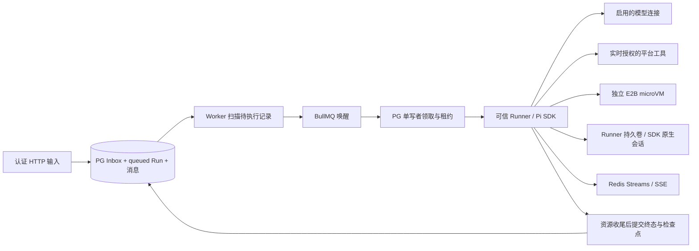

# 云端 Agent 后端

日期：2026-11-16。已实现云端执行、会话分页及生命周期后端，无新增前端。真实模型验证仅使用 DeepSeek；第二供应商使用本地受控响应验证配置和 SDK 适配，不表示实际调用过该供应商。

## 执行路径



`Agent` 保存可复用指令、默认模型、推理强度与可见性。`Session` 保存持续会话、下一次 Run 的配置、执行器检查点和绑定沙箱。`Run` 保存一次输入的配置快照与执行状态。同一 Session 按输入顺序执行，一个 Run 的模型循环完成后再开始下一个；当前没有中途 steering 或 follow-up 投递。

API 和 Worker 使用同一代码库，独立进程。Runner 是 Worker 内可信执行职责，目前不另起 Runner 服务。Pi 管模型和工具循环、上下文及原生 SessionManager；应用不复制它的循环。E2B 通过公开工具 operations 提供文件和命令能力，不把 Pi/Runner 放入用户沙箱。

## 接口

以下接口均要求真实登录会话，修改请求须满足同源要求；Workspace 管理继续使用 Better Auth organization 的官方接口。

| 方法 | 路径 | 作用 |
| --- | --- | --- |
| GET | `/api/agents/models` | 启用供应商的模型、推理强度和部署默认模型 |
| POST | `/api/agents` | 创建 Agent：workspaceId、name、visibility、instructions、model、reasoningEffort |
| PATCH | `/api/agents/:id` | 部分编辑名称、默认配置、可见性和 active/disabled |
| DELETE | `/api/agents/:id` | 删除无任何 Session 的定义；仍有会话返回 409 has_sessions |
| GET | `/api/agents?workspaceId=...` | 当前用户可见的 Agent，最多 100 条 |
| POST | `/api/sessions` | 从 agentId 创建私有会话 |
| GET | `/api/sessions?workspaceId=...` | 当前用户在指定 Workspace 的私有会话分页，含执行状态 |
| GET | `/api/sessions/:id` | 会话、当前或最近 Run、最近 50 条持久消息及历史游标 |
| PATCH | `/api/sessions/:id` | 部分修改 title、active/archived；title=null 清除自定义名称 |
| DELETE | `/api/sessions/:id` | 接受不可撤销的异步删除，返回 202 与清理进度 |
| GET | `/api/sessions/:id/deletion` | 读取删除进度；完成或没有访问权返回 404 |
| GET | `/api/sessions/:id/messages` | 向前翻页读取更早的持久消息 |
| PATCH | `/api/sessions/:id/configuration` | 修改 instructions、model、reasoningEffort；只影响随后提交的 Run |
| POST | `/api/sessions/:id/messages` | 提交 sourceEventId、text，返回新建或重复的 Run |
| POST | `/api/sessions/:id/runs/:runId/cancel` | 持久取消请求 |
| GET | `/api/sessions/:id/events` | SSE，支持 Last-Event-ID |

模型引用是 `{ provider, id }`，推理强度是模型目录返回的字符串。型号和强度由 Pi 的公开 API 提供，契约不复制厂商枚举。Agent 创建时先校验选择；部分更新模型/强度时在锁内合并当前值再校验。名称、可见性和停用不要求旧模型仍在目录中。每次输入在事务中保存 Session 当前配置，因此已排队和执行中的 Run 不受随后修改影响。用户自带密钥管理仍属后续功能。

Owner/Admin/Member 可以创建和使用 Agent，Viewer 只读可见定义。Agent 可见性可选 private 或 workspace，省略时默认 private；私有 Agent 仅创建者可用。Session 始终只对其创建者开放，并要求当前 Workspace 成员权限；能查看共享 Agent 不等于能查看别人的对话。工具执行和租约轮询重新检查当前权限；工具准入在权限查询的锁等待结束后核对有效租约，订阅也持续复核登录有效性与成员身份；登出、会话过期或撤销后，已有连接结束收流。

## 编辑、归档与资源回收

Agent 创建者在当前 Workspace 有写权限时可编辑自己的定义；Owner/Admin 还可管理 Workspace 可见定义。角色能力由 Better Auth statements 提供，应用继续检查所有者与可见性；管理员不能因此读取私人 Agent 或别人的 Session。部分编辑不能修改 workspaceId、createdBy，省略字段保持原值。默认指令/模型/强度修改只影响之后新建的 Session；已有会话可用 configuration 接口显式修改。

disabled 保留可见的定义和历史，拒绝新 Session、新输入和模型配置准入。已排队输入在领取时取消，运行中执行在每秒续约或工具准入时观察停用并合作取消；外部效果不能撤销，未知结果仍进入 recovery_required。停用/启用表示当前可用性，明确停止某个 Run 仍使用持久 cancel 接口。停用后，本人仍可在当前 Workspace 写权限下命名、归档、取消和删除会话。

Session 默认 title=null、status=active；归档不取消已有 Run，也不删除检查点。列表默认查询 active，`status=archived` 查询归档记录，两种列表都包含 title/status。提交真正的新输入时，恢复 active 与 Inbox/Run/用户消息原子提交；重复输入仅返回原 Run，不修改归档状态。新创建记录的时间顺序仍固定，游标记录已经物理删除时返回 invalid_cursor，需要从首页重新读取。

删除先锁 Session，与消息准入及执行领取使用同一锁。存在 queued/running/cancelling 时返回 `409 { code: "busy" }`，需先取消并等待收尾；存在 recovery_required 时返回同名 409，需先人工核对，不提供 force 参数绕过。接受后返回 `{ sessionId, status: "deleting", requestedAt, attempts, nextAttemptAt, errorCode }`，重复 DELETE 返回当前进度。errorCode 为 null 或 resource_cleanup_failed，供界面翻译；原始 SDK 诊断不进入响应。普通读取、写入和 SSE 立即失去访问；GET deletion 仍要求本人身份和当前成员读权限。删除请求不可恢复成活跃会话。

PG 保存删除请求及重试进度。现有 Worker 扫描到期请求，用独立的 delete-session Job 唤醒，短更新将尝试数加一并保留 60 秒的重试间隔；远端 I/O 不持有事务。先通过 E2B 控制面结束绑定 VM，再移除 Session 专属目录中的所有 Run/attempt，清理事件，最后事务删除 Session 及级联 Run/消息/工具记录与对应 Inbox。E2B 已不存在、目录已不存在与重复最终提交都可正常完成。API/Worker 必须使用同一部署连接和持久会话卷。

失败保留资源身份和稳定错误码，退避从 2 秒增长至最多 5 分钟；原始诊断留在日志。进程中断后到期可重试，重复释放针对同一不可复用身份，不引入业务副作用重跑。Worker 停止先等待 SDK、沙箱及文件操作，再启动队列传输的 5 秒退出期限；正常关闭等待最终提交，传输故障保留待清理进度并明确报告失败。已被成员授权接受的删除会继续处理，后续撤权不会把它变成孤立资源；进度读取仍立即受当前权限约束。Redis 是有期限的传输窗口，迟到通知不能恢复已删除的产品会话或访问权。

Agent 仍有任何 Session（包括归档和正在清理）时不能删除，防止级联影响别人的对话；会话回收后可删除空定义，再通过官方 organization 接口删除空 Workspace。没有新增回收站、恢复删除、自动处理未知工具效果或会话存续期间的旧检查点淘汰。设计与官方依据见 [ADR-0003](adr/0003-agent-session-lifecycle.md) 和 [生命周期调研](research/agent-session-lifecycle.md)。

## 会话列表与历史分页

列表和历史接口接受 `limit`（默认 50，范围 1–100）与可选 `cursor`，响应分别为 `{ sessions, nextCursor }` 和 `{ messages, nextCursor }`。`nextCursor: null` 表示这一方向已无更多记录。非法参数返回 400；当前没有资源访问权返回 404；登录失效返回 401。游标格式正确但记录不属于当前用户、Workspace 或 Session，返回 `400 { code: "invalid_cursor" }`，不会透露该记录实际归属。

列表按 `createdAt DESC, id DESC` 排序，游标对应上一页最后一个 Session。创建顺序固定，运行状态变化不移动会话；新创建的会话从首页读取。每项仅包含 `id`、`agentId`、`workspaceId`、`createdAt` 和 `run`，不返回指令、检查点或沙箱身份。`run` 优先选择 running、cancelling、recovery_required，随后才按创建时间和 ID 选择最近记录；没有 Run 时为 null。因此，较新的 queued 输入不会遮住当前执行或待核对的副作用。

历史从最新一页开始，游标指向该页最早一条消息；下一页查询位置更早的消息。每页内部按 `position` 升序返回，接入方按消息 ID 合并后仍按 position 排序。新消息追加不会改变已发出的历史游标；默认窗口和 HTTP/SSE 快照均为最近 50 条。列表游标与消息游标是各自资源的 UUID，接入方应原样回传，不从时间戳或 position 自行构造。

例如，先读取 `/api/sessions?workspaceId=W&limit=20` 找回私有会话，再读取 `/api/sessions/S` 获取当前状态和最近消息；需要更早内容时请求 `/api/sessions/S/messages?cursor=C&limit=50`，C 为快照或上一页的 nextCursor。重新登录不创建新 Session，继续通过原 Session 的消息接口提交输入。Viewer 可以读取自己的既有历史，但不能提交新输入；移出 Workspace 后列表、历史与快照均失去访问权。

数据库使用 keyset 查询，列表索引覆盖 Workspace、创建者和创建顺序，Run 索引覆盖当前状态优先级。时间边界在 PG 内保持微秒精度，避免 JavaScript Date 的毫秒精度造成漏页；参考 [Drizzle 游标分页](https://orm.drizzle.team/docs/guides/cursor-based-pagination)、[Drizzle Lateral Join](https://orm.drizzle.team/docs/joins) 和 [node-postgres 时间类型](https://node-postgres.com/features/types)。历史使用已有 Session + position 唯一索引反向扫描，不新增通用分页框架。

## 输入与状态

`sourceEventId` 在 Session + 来源范围内唯一。同身份、同文本返回原 Run；同身份、不同文本返回冲突。Inbox、queued Run、用户展示消息在一个 PG 事务提交。BullMQ 只携带 Run ID，即使 Redis 重建，PG 待执行记录仍可再次唤醒；数据库领取与唯一约束防止重复执行。队列不保留已失败的唤醒 ID，领取前失败的 queued 记录可以再次投递；已领取或结果不确定的执行由 PG 状态阻止重跑。

Run 状态为 queued、running、cancelling、completed、cancelled、failed、recovery_required。取消排队项立即生效；执行项在租约轮询和工具授权处观察取消，SDK 和沙箱收尾完成后提交终态。浏览器关闭只断开订阅。与成功响应竞态的已提交取消请求优先，真实收尾失败或未知副作用仍保留失败事实。

租约使用 PG 时钟，20 秒有效、每秒续约。所有消息、工具回执、环境绑定和最终提交都核对 owner token 与租约。过期所有者进入 recovery_required，不把不确定的一轮交给新进程直接重跑。排队输入仍保留，但会话在核对前停止继续。

## 检查点与沙箱

平台保存不透明 JSON 检查点，只有具体执行器解释其格式。Pi 适配器保存原生 JSONL 文件引用，接续时复制 SDK 原始字节到新 attempt 目录，再通过公开 SessionManager 打开。旧 owner 不能修改已经提交的检查点文件。展示消息仅供产品读取，不用于重建模型上下文。

API 和 Worker 的 AGENT_SESSION_DIRECTORY 必须指向相同的持久文件系统；当前实现适用于单机或明确共享该卷的部署。普通临时容器目录不具备重启持久保证。尚未实现对象存储同步、旧检查点自动回收或任意 SDK 版本迁移；部署必须保留原生会话卷。压缩后的跨版本迁移和跨供应商长对话仍需专项验证。

E2B 按需创建：纯文字或平台工具调用不创建 VM。Session 绑定 sandboxId；新建使用 Session ID 作幂等键，并记录 application、workspaceId、sessionId 元数据。Run 结束严格暂停，同一绑定下次恢复。绑定不存在时报告失败并保留旧身份，不能创建空 VM 冒充恢复；原生会话仍可用于后续纯文字输入。

沙箱文件通过 E2B 官方流读取，单次最多 20 MiB，超限明确报错并取消下载；它限制实际收到的字节，不依赖会被并发修改的文件大小元数据。取消信号传给文件请求，但中断上传不等于确认远端写入停止。

read/write/edit/bash 使用 Pi 官方工厂，启用工具的文件和命令操作全部委派远端；不启用仍访问 Runner 的其他工具。Bash 截断的大输出文件通过 Blob 转移到沙箱 `.agent-outputs`，移除 Runner 临时文件并修正模型可见路径。SDK 出错路径自身的临时文件策略仍归上游实现。

命令取消向独立进程组发送信号并等待退出确认，覆盖普通子进程；不承诺撤销已产生的效果或终止另行脱离会话的守护进程。平台密钥、Pi 会话文件、主机环境和本机用户配置不提供给工具。

工具写入、建目录和命令在执行前持久记录意图，得到确认后提交回执。确认丢失时保留 pending，进入 recovery_required；首版没有自动副作用对账、恢复操作 API 或 exactly-once 保证，需运维核对原生历史、沙箱和工具记录。纯读工具不记副作用意图。

有 Agent 的 Workspace 仍返回 409，数据库外键阻止级联清除资源归属。先按生命周期接口回收会话、删除空 Agent，再删除 Workspace。开发测试只清理自己创建的记录和 VM；会话存续期间的留存容量与旧检查点淘汰仍需在生产长期运营前完善。

## SSE 对账规则

Redis 保存约 2,000 条事件，最后一次写入后保留两小时。每个订阅使用自己的阻塞连接，持续复核登录与资源访问；游标过期、流丢失或游标超前时发 reset，携带 PG 快照。空闲心跳对比 PG Session revision，变化时补发 snapshot，因此排队取消、租约过期和通知丢失不会让已连接客户端永久停留在旧状态。snapshot 可以在连接期间多次出现。snapshot/reset 不表示模型执行结束；最终结果以 Run 状态及已确认消息为准。

update 包含 message、run 或 tool。草稿消息采用同 message.id 的累计文本替换，不是可重复拼接的 delta。客户端须按消息 ID 合并，completed/interrupted 不得被回放的 pending 覆盖；两份 pending 合并时保留较长的累计文本，PG 快照不能清空已观察到的草稿；Run 按 ID 合并，终态不得被旧 running 覆盖。工具进度只是短期观测。快照之后仍可能回放旧事件，因此这些规则是接口约束。

snapshot/reset 的 messages 是最近窗口，不代表完整历史。合并时保留已加载的更早消息，以及窗口之外已观察到的草稿。nextCursor 描述这次窗口的向前分页边界：首次加载可用它开始读旧历史，已在翻页时保留自己的历史进度。如果断线后的新窗口与已有消息不重叠，应从新窗口的 nextCursor 向前补页，直到与已有历史衔接或读完；这次补页进度独立于更早历史的翻页进度。短期事件回放与分页可能包含同一条消息，仍按 ID 去重。分页仅影响产品展示，Pi 继续从原生会话检查点恢复模型上下文。

消息与 Run 载荷中的 Session ID 必须匹配当前订阅，归属不符的事件不会交付，订阅报告 unavailable 后结束。工具进度只携带 Run ID，依赖发布者将其写入该 Run 所属 Session 的流。

当前累计草稿方式便于补流，长文本的传输总量会增加，尚未做规模压测。消息分页限制单次条数，不限制单条文本的字节数。Redis 不是永久消息历史；PG 保存确认边界，未确认草稿可能在进程崩溃时丢失。access_revoked 结束订阅，unavailable 表示依赖失败，应重新连接并对账。

## 配置、启动与验证

先按 [本机 E2B](../deploy/e2b/README.md) 启动官方 Embed。`.env.local` 配置 DeepSeek、E2B API key 和绝对会话目录；模型凭据只由 bootstrap 启动时解析。默认仅 DeepSeek；多供应商部署使用 MODEL_PROVIDERS 引用各密钥的环境变量名，不能把密钥写进产品配置或 API 响应。无云端执行配置时关闭 Agent 执行接口，Worker 直接退出，原有认证和健康接口仍可用。

Worker 停止时先等待 SDK 与沙箱资源收尾，再启动 5 秒队列 I/O 退出期限。期限到达只断开它拥有的 Redis 连接，并报告收尾错误。这个期限不截断 SDK/沙箱清理，也不把连接丢失视作执行成功。

```sh
pnpm infra:up
pnpm db:migrate
pnpm dev
pnpm test
pnpm test:integration
pnpm test:sandbox
pnpm test:cloud
```

普通 CI 不依赖真实模型或 E2B key。sandbox 测试启动真实 Firecracker VM，cloud 测试实际调用 DeepSeek 并贯通 HTTP、认证、PG、BullMQ、Pi、E2B 和 SSE，会产生模型用量。测试仅删除自己的数据与 VM。验证明细见 [执行链路审查](reviews/cloud-agent-2026-11-15.md) 和 [全仓代码审查](reviews/codebase-style-2026-11-15.md)。

会话分页的真实 PG/Redis 验证位于 [sessions.test.ts](../tests/integration/sessions.test.ts)：覆盖相同时间戳及相邻微秒、分页期间新增记录、跨用户/空间/会话游标、执行与恢复状态优先级、HTTP/SSE 窗口对账、重新登录后继续执行和实时撤权。

生命周期验证位于 [lifecycle.test.ts](../tests/integration/lifecycle.test.ts)：覆盖当前角色/可见性、模型合并、配置快照、停用、归档、删除与输入竞态、忙碌/未知状态、失败重试、过期清理尝试和 Worker 重启。存储单测验证路径隔离、重复删除与符号链接；cloud 测试另验证真实暂停 E2B、所有 attempt 文件及重复释放，不额外调用模型来生成测试文件。

Router/长期 Task、Timers、跨会话 Memory 整理、审批、Outbox 和本地 Connector 留待后续实现。它们复用持久输入、执行所有权和工具边界，不引入第二套模型循环。
