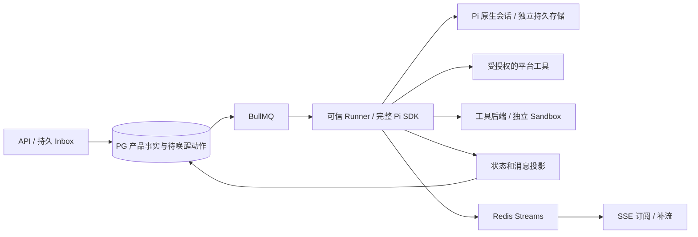

# 云端 Agent：架构研究与执行方案

日期：2026-11-15。状态：研究及首版实现记录，云端执行已经落地；历史静态阅读范围保留如下。本文明确下一阶段以平台自有云端 Agent 为主，Pi 提供模型和工具循环；本地 Codex、Claude Code 等设备接入是另一条后续路径。

## 阅读范围与证据

本次获取 LobeHub canary `3318b7cbcf3c6f4933c30d9ee4a3daec4e467927`，与本地已读快照 `11a57dc4c0f04a99441cdd1c883c86c5fc0cd74e` 比较。下列 Agent schema、状态与流管理、恢复服务、Gateway client、工具结果重放及 operation 状态接口未变化。不是对全部仓库的审计，也未运行 LobeHub 测试。

Pi 获取 `c3cc91632d0a1950fb122605b190233f2aa0006e`，与已读快照 `c815ddaa3736bd0b009ce6a997ee5003f8a3a532` 比较。本次涉及的 Agent Core 源码与 README 未变化；durable README 新增的是图片处理示例。此处记录当时的源码与测试代码复核范围；后续已安装 Pi 1.5.2 并完成真实 DeepSeek + E2B 链路，实际验证边界见文末。

重点阅读：

| 问题 | 源码与证据 |
| --- | --- |
| Agent 定义和运行记录 | [agent schema](https://github.com/lobehub/lobehub/blob/3318b7cbcf3c6f4933c30d9ee4a3daec4e467927/packages/database/src/schemas/agent.ts)、[agentOperations schema](https://github.com/lobehub/lobehub/blob/3318b7cbcf3c6f4933c30d9ee4a3daec4e467927/packages/database/src/schemas/agentOperations.ts) |
| 状态存储、锁、继续位置 | [AgentStateManager](https://github.com/lobehub/lobehub/blob/3318b7cbcf3c6f4933c30d9ee4a3daec4e467927/apps/server/src/modules/AgentRuntime/AgentStateManager.ts) 的序列化、保存、加载、inline envelope 和锁实现；Coordinator 的相应调用 |
| 执行一步和故障恢复 | [executeStep](https://github.com/lobehub/lobehub/blob/3318b7cbcf3c6f4933c30d9ee4a3daec4e467927/apps/server/src/services/agentRuntime/AgentRuntimeService/executeStep/index.ts)、guards/runStep/continuation/failure 的相应路径，[StaleOperationReaper](https://github.com/lobehub/lobehub/blob/3318b7cbcf3c6f4933c30d9ee4a3daec4e467927/apps/server/src/services/agentRuntime/StaleOperationReaper.ts) |
| 工具结果复用 | [toolReplay](https://github.com/lobehub/lobehub/blob/3318b7cbcf3c6f4933c30d9ee4a3daec4e467927/packages/agent-runtime/src/executors/toolReplay.ts)、toolPersistence 和 tool.replay.test 的结果复用、占位符、错误及调用身份用例 |
| 流、历史和客户端重连 | [StreamEventManager](https://github.com/lobehub/lobehub/blob/3318b7cbcf3c6f4933c30d9ee4a3daec4e467927/apps/server/src/modules/AgentRuntime/StreamEventManager.ts) 全文；GatewayStreamNotifier 的发布和顺序屏障；[Gateway client](https://github.com/lobehub/lobehub/blob/3318b7cbcf3c6f4933c30d9ee4a3daec4e467927/packages/agent-gateway-client/src/client.ts) 的认证、重放与完成判断；messagePatch 和 operationStatus 的相应实现 |
| Pi 可用的公开扩展 | [Agent Core README](https://github.com/earendil-works/pi/blob/c3cc91632d0a1950fb122605b190233f2aa0006e/packages/agent/README.md)、agent.ts 的订阅/控制/continue、agent-loop.ts 的事件屏障与 runToolCall；durable README 的实验性说明 |

## LobeHub 实际采用的设计

### Agent、会话和运行分别建模

Agent 保存名称、指令、provider/model、参数、工具及聊天配置、创建者和 Workspace 归属。AgentOperation 单独保存本次运行状态、模型配置快照、开始结束时间、成本、错误及上下文引用。它自己的 Runtime 处理循环，不使用 Pi。

所读 Agent schema 中，Workspace 内可见性默认是 public；本产品此前提出的默认私有属于自己的政策，不能归因于 LobeHub。共享 Agent 和共享会话记录也应分别决定。

### 恢复依靠明确的状态和下一步上下文

AgentStateManager 把运行状态和下一步上下文等写入 Redis，默认 TTL 两小时；正常消息可从 PG 重建，状态序列化时会省去这些消息。操作的长期记录在 PG。文件/S3 trace 用于追踪，不能仅凭存在 trace 就断言它是自动恢复的来源。

executeStep 检查持久终态、领取带 owner 的 Redis 操作锁、加载状态，跳过过时或不允许执行的步骤，执行后保存结果，再安排后续步骤。inline 连续执行前先保存下一步 envelope，给队列重投保留继续位置。

StaleOperationReaper 从 PG 的过期运行记录出发，结合 Redis 状态及真实 continuation context 重新排队；有次数上限，并排除等待人工或异步工具的状态。状态缺失并不等价于“从聊天记录重新跑一下”。

这些机制有适用边界：运行状态会过期；所读锁领取在 Redis 错误时允许继续；提交前的锁刷新与状态写入不是同一原子操作，源码也说明这一窗口。这是静态实现观察，不能扩大为线上故障结论，也不作为我们的默认一致性政策。

### 已提交的工具结果优先复用

toolReplay 按 assistant 消息和 tool call 的身份找既有工具消息。完整结果可以直接复用，包括已保存的失败和内容为空但执行元数据完整的结果；读取结果失败会传播错误。占位符和 pending 状态另行处理。

这能避免“结果已提交，但旧 checkpoint 被重投”时再次产生副作用；它不能证明“外部副作用已发生、结果尚未写入”的窗口也满足 exactly-once。本产品必须单独处理后一种情况。

### 实时分发与持久消息对账并存

StreamEventManager 使用 Redis XADD 保存事件，按 cursor 分页回放；TTL 随写入刷新。历史缺失会返回 unavailable，不拿一个被截断的后缀冒充完整历史。XREAD BLOCK 使用独立连接，避免阻塞同连接上的发布命令。

Web 路径还使用 Gateway WebSocket 和多路复用。Gateway client 会携带 lastEventId 重连，并读取 resume_complete 给出的状态；不能因为没有回放事件就判定运行完成。替换一个浏览器订阅也不会停止服务器执行。

新协议通过带 revision 的 message_patch 对齐持久消息，不持续发送全量会话。GatewayStreamNotifier 将 stream_end、message_patch 作为顺序屏障，保证最终内容和规范消息更新先于后续完成通知。Gateway 服务端的全部实现不在本次审计范围内。

## Anthropic：Harness、执行沙箱与会话存储分离

复核 [Scaling Managed Agents: Decoupling the brain from the hands](https://www.anthropic.com/research/managed-agents)，发布于 2026-04-08。其最初将会话、harness 和执行环境放入同一容器，之后拆成三个可以独立替换的部分：

- Harness 在执行沙箱之外调用模型和路由工具。
- Sandbox 只承载实际执行，可按需创建或恢复；失效通过工具调用暴露给 harness。
- Session 的持久记录独立保存，供新的 harness 获取历史并继续；完整历史与当前模型上下文分别维护。

文章讨论了同容器方案的故障耦合、诊断困难、环境连接限制与凭据暴露问题。补充的 [Managed Agents 架构文章](https://claude.com/resources/articles/building-with-claude-managed-agents) 还解释了模型开始推理无需等待沙箱启动。

对应本产品：Runner/Pi 位于平台可信计算环境；用户代码及命令只在独立 Sandbox 执行；Pi 原生会话位于独立持久存储，不能依附用户 Sandbox 的生命周期。Runner 自身可以容器化部署，但不能与用户代码共享执行环境。此前为减少工具适配而提出的同沙箱运行方案撤回。

这里采用的是故障域与资源所有权的划分，不意味着首版新增三套微服务，也不复制 Managed Agents 的全部协议。Pi 的公开会话、压缩与工具循环继续复用，其跨进程恢复能力仍需本产品验证，不能直接套用 Anthropic 服务的恢复承诺。

## 收敛后的建议：优先复用完整 Pi SDK

用户补充了两个硬目标：必须支持多个模型供应商；尽量减少自有 harness 的维护，把投入放在实际任务效果。按这两个目标，本次提案调整为优先验证 Pi Coding Agent SDK 的完整会话能力。此前默认使用 Agent Core、再由平台补齐会话重建和恢复调度的建议不再作为首选。

Pi Core 代码范围小，不代表使用它后平台需要维护的代码少。完整 SDK 的 AgentSession 已拥有会话、模型和工具、输入队列、压缩状态和扩展运行时；SessionManager 管理持久条目树及有效模型上下文。是否适合通用 Agent，按指令、工具和公开扩展的实际可定制性验证，不仅凭包名判断。

证据：[完整 SDK 文档](https://github.com/earendil-works/pi/blob/c3cc91632d0a1950fb122605b190233f2aa0006e/packages/coding-agent/docs/sdk.md)，以及本地 sdk.ts 的公开配置和创建流程。Pi 的 [provider 文档](https://github.com/earendil-works/pi/blob/c3cc91632d0a1950fb122605b190233f2aa0006e/packages/coding-agent/docs/providers.md) 明确列出 Anthropic、OpenAI、DeepSeek、Gemini 等供应商。

多模型并非 Pi 独有：OpenAI Agents SDK 有公开 Model 接口和 [AI SDK 适配器](https://openai.github.io/openai-agents-js/extensions/ai-sdk/)，Vercel AI SDK 自身也有 [ToolLoopAgent](https://ai-sdk.dev/docs/agents/building-agents)。不能把它们描述为完全不支持多模型或必须从零写循环。当前偏向 Pi，是基于希望复用一个可嵌入、可扩展的完整执行实现；尚无基于本产品原型的维护成本或效果比较结论。

### 让 SDK 和平台各自拥有状态

| 所有者 | 维护什么 |
| --- | --- |
| Pi | 模型和工具循环、原始转录、上下文组织与压缩、原生会话格式、已有工具和扩展生命周期 |
| 平台 | Workspace/资源授权、Agent 配置和模型连接引用、输入与唤醒、Run 状态、预算、Sandbox 生命周期、对外事件与结果投递 |
| 集成模块 | Pi 会话引用、公开配置和事件的映射、启动/停止/释放、版本兼容验证 |

SDK 已经提供的能力，优先使用它的公开配置和扩展。只有真实任务或故障原型证明能力缺失时，才增加对应逻辑；不预建一套与 Pi 重复的 SessionManager、压缩器、工具调度器或通用图执行框架。

PG 继续保存产品事实、输入、Run、会话引用和用户可见消息投影。Pi 的原生会话由其 SessionManager 管理，并放在有持久保障的存储中。投影从 SDK 事件和已确认会话中同步，不作为第二套可以独立修改的模型上下文。

这修正此前“先设计我们的完整消息/checkpoint 格式，再让 Pi 适配”的方向。先证明 SDK 原生会话能够满足恢复，再确定它的存储部署；不能为了写进 PG 而绕过 SDK 的有效条目树和压缩语义。采用文件会话时，必须有持久卷或已验证的快照/恢复路径；PG 保存引用不等于会话文件已经持久。

多模型配置包含供应商连接、模型 ID 和必要的特有参数；凭据独立管理。Router 和工作 Agent 可以选用不同模型，同一个 Run 记录当次选择。模型切换、推理内容、工具调用和历史压缩后的上下文，需要跨供应商用例验证，不能仅凭模型名称可配置就声称语义完全一致。

### 官方 SDK 的接入方式与升级约束

本方案对应 [docs.pi.dev/latest/sdk](https://docs.pi.dev/latest/sdk) 的 `@earendil-works/pi-coding-agent`，通过公开的 `createAgentSession()` 嵌入 Runner；现已安装并接入 1.5.2 发布包。不是仅采用 Agent Core 后自行补齐完整会话引擎。

- 创建时显式提供模型、凭据来源、工作目录、设置、资源和工具。沿用官方 [完整配置示例](https://github.com/earendil-works/pi/blob/c3cc91632d0a1950fb122605b190233f2aa0006e/packages/coding-agent/examples/sdk/12-full-control.ts) 展示的公开配置入口，避免继承部署机器的用户配置。通用 Agent 的系统指令和可用工具由平台选择；不因为 SDK 包名包含 coding 就固定为编程任务。
- 复用公开的 prompt、steer/followUp、订阅、abort 和释放入口，以及原生 SessionManager。集成模块集中解释 Pi 的事件和生命周期，不覆盖私有方法、不深层导入内部文件、不 fork 循环，也不为每个 SDK 方法增加同名转发。
- 平台工具通过公开工具或扩展入口接入。资源授权和副作用确认由相应业务工具维护；集成模块不成为全业务工具清单和权限策略的所有者。
- Pi 类型留在集成模块及其工具扩展内。向应用交付运行结果与必要的展示事件；不把 Pi 的所有事件和类型复制成一套对称的“通用 SDK”，也不让数据库、Workspace 和流订阅依赖 Pi 内部类型。
- 使用当时最新且通过验证的发布版并锁定依赖和 Runner 镜像版本；升级通过正常依赖更新及回归完成，不在运行中自动替换 SDK。存量会话的打开、压缩后继续、工具调用、流事件、取消和关闭，是升级检查的重点。版本变化影响会话格式时先验证公开迁移路径，不能只依赖 TypeScript 编译通过。

Sandbox 通过工具执行后端接入，Runner/Pi 保留在平台可信计算环境。Pi 的公开 `createBashTool`、`createReadTool`、`createWriteTool`、`createEditTool` 等工厂支持注入对应 `operations`；官方 [SSH 扩展示例](https://github.com/earendil-works/pi/blob/c3cc91632d0a1950fb122605b190233f2aa0006e/packages/coding-agent/examples/extensions/ssh.ts) 已展示工具操作委派给远端的方式。我们在这些公开入口对接 Sandbox provider，沿用 Pi 的工具 schema、输出处理和模型循环；不复制示例的 SSH 命令拼接实现，也不把示例视为完整云端隔离保证。

启用的文件、搜索、目录、命令及其他代码执行工具全部绑定相同的授权 Sandbox；未接入远端的内置工具不启用，不回退到 Runner 的本机文件或进程。扩展仅加载平台可信实现，其他可能触发本机执行的输入入口也须限制。默认后端和外接 E2B 等后端由 Sandbox 模块管理创建、连接、持久目录、取消与释放；不需要执行环境的模型或平台工具调用不强制先创建 Sandbox。

Pi 的模型凭据、平台管理凭据和会话持久目录不向用户 Sandbox 暴露。业务工具由可信端校验授权，必要的沙箱访问凭据单独限定范围；不能将 Runner 的环境变量整份传给远端命令。沙箱失效时区分命令失败、执行结果未知与工作空间丢失，不能自动建立空目录冒充已恢复原工作。

### 云端执行与订阅分离

Worker 负责领取和派发，可信 Runner 拥有一个受管理的 Pi 会话及其工具连接。API 不跟随一个长 HTTP 请求托管模型循环。用户命令和文件操作通过工具后端进入独立 Sandbox，SDK 默认发现的主机目录、配置和凭据必须被显式的会话配置替代。

首版只接云端 Pi，Runner 与用户代码 Sandbox 分离。具体 provider 和公开工具操作的映射通过原型收敛。沿用 agents、sessions、tasks、sandbox、agent-runtime 的现有职责，不提前增加本地设备连接、多个执行器或新的微服务。

### 三种恢复分别验证

| 场景 | 责任与建议行为 |
| --- | --- |
| 浏览器刷新/断线 | 平台按游标补事件并同步持久投影；原运行继续，重连不创建新 Run |
| 云端 Runner 重启 | 优先用 Pi 的原生持久会话和公开恢复入口；平台核对单写者、Run 身份与继续条件 |
| 外部工具已产生效果但缺少确认 | 工具/Sandbox 提供执行凭据或幂等键；结果未知时核对或等待，不能把 SDK resume 宣称为任意副作用的 exactly-once |

原生会话可以打开，不等于中途任何工具都能安全自动重放。需要检查真实实现和杀进程原型，分别处理模型生成中、工具执行中、结果已确认、等待批准等位置。完整 SDK 也不能免除平台跨请求的资源授权和执行所有权。

同一 SDK 会话保持单写者。租约过期不会直接授权另一个进程同时写同一份会话文件；先确认旧 Runner 停止，或由存储/执行环境可靠地隔离旧写者。输入和待唤醒动作在 PG 同事务提交，重复队列投递按持久身份核对。

SDK 的 agent_end 不直接等同产品 Run 结束：完整 SDK 文档区分低层 agent_end 与 agent_settled，自动恢复和排队输入仍可能继续。平台完成通知需要绑定正确的完成边界。

### 流式传输借鉴 LobeHub 的语义

首版采用 HTTP 写入/取消、SSE 输出，沿用现有 API/Worker 和 Redis Streams。LobeHub 的 Gateway WS/mux、兼容协议与全部类结构不随之移植。

- 事件携带 Run、执行身份、消息/工具身份和游标。流游标与持久投影 revision 分别表达传输进度和已确认状态。
- 草稿增量有界合并；完整消息、工具结果和终态以已确认 SDK 状态及持久投影对账。Pi 原生事件由集成模块解释，不扩散到前端和其他功能。
- 流重连校验保留范围，过期或 Redis 数据丢失时明确要求重新同步；不能从 `$` 静默跳过，也不能将没有事件判为已完成。
- 快照与订阅有明确锚点及去重规则；模型响应重试时明确替换旧草稿，不把两次输出拼接成一个回答。
- 订阅关闭只释放订阅；取消是独立持久操作。长期订阅有授权复核、背压上限和心跳，XREAD BLOCK 使用独立连接。
- 高频 token 草稿不作为永久恢复日志。SDK 会话文件、持久消息投影和结果的确认顺序，需要独立验证；重连成功不能掩盖执行状态已经丢失。

### 开发投入和验收

优先投入工具质量、上下文、评估用例、失败样本、模型选择、成本和速度，而不是先扩大运行框架。强模型可以承担更多任务分解和路由判断；权限、隔离和副作用确认仍由确定的代码约束。

首个原型复用完整 SDK，覆盖一个非编码任务和一个 Sandbox 任务。根据最新用户范围，一期只接入和真实调用 DeepSeek，不接入或调用 Anthropic；多供应商能力保留在 Pi 的公开接口中，不作为一期双供应商验收：

1. 正常工具循环、流式输出、多轮接续、取消和资源释放。
2. SDK 原生会话在 Runner 重启后可按公开入口继续，压缩后的上下文也能恢复。
3. 工具仍在运行、执行回执丢失、结果已持久三个位置分别杀进程，不自动重复副作用。
4. 审批等待的进程与会话生命周期；不把等待误写成已完成或普通工具失败。
5. 浏览器重连、游标过期、Redis 中断和数据库中断的行为。
6. 不同空间/用户的目录、原生会话、凭据和流订阅隔离。
7. 上游升级后的历史会话、事件顺序及取消回归。
8. Sandbox 被终止或替换时，Runner、订阅和原生会话仍可用；模型凭据和平台文件不可由任一启用工具读取，取消需核对远端执行已经停止。工具的大输出截断、完整输出文件、图片和路径语义也按远端环境验证，不能向模型返回仅在 Runner 本机可读的产物路径。

如某项需要复制 SDK 私有循环、平行维护会话状态或持续打补丁，先重新评估使用层级和替代方案。不会因 Pi 源码较少就认定产品总维护成本更低，也不在尚无原型时宣称已经完成恢复保证。

Router 后续可使用相同 Pi 实现和独立模型/工具配置，Timer 向同一个 Inbox 投递，记忆和渠道 Outbox 按实际业务落地。它们延续 Claude 的长期运行部件与 DSH 的 Router/Worker 分工，不需要提前构造第二套模型循环。

## 2026-11-15 实现与验证

已按公开完整 SDK 接入原生 SessionManager、模型目录、推理强度和工具 operations。共享执行边界只有必要观测、受控执行能力和 JSON 检查点，平台不解释 Pi 文件路径，不建立全量 SDK 镜像或空的多执行器注册表。工具清单在组合根绑定，Workspace、数据库和订阅不依赖 Pi 类型。

M5 本机运行官方开源 E2B Embed，可信 Runner 与 Firecracker VM 分开。实际验证包含 DeepSeek 工具循环、纯业务工具、文件/命令、暂停恢复、正常 Worker 重启后接续、模型/强度切换、绑定沙箱丢失后保留会话、SSE 补流、取消和未知回执隔离。完整说明见 [云端 Agent](../cloud-agent.md) 与 [本轮审查](../reviews/cloud-agent-2026-11-15.md)。

未验证生产规模、完整进程强杀矩阵、压缩后跨版本升级、任意跨供应商长会话或审批恢复。中断的一轮进入 recovery_required，首版不做自动副作用对账。这些限制不能用原生会话可打开或测试通过来替代。
