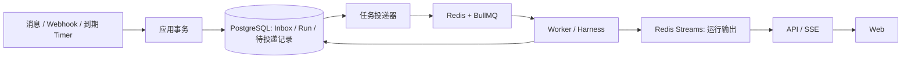

# 后台队列、Redis Streams 与持久状态的分工

研究日期：2026-11-14。

状态：用户已确认 PostgreSQL 持久化、Redis + BullMQ 调度、Redis Streams 运行事件。下文保留比较依据；尚无实现或性能验证。

## 需求与当前判断

本产品需要长期运行、多用户、多 Agent、多 Worker、审批后恢复、实时输出及断线后补读。吞吐量和可用性目标尚未确定，不能据此断言某个队列的性能足够或不足。

先前的 Graphile Worker 建议优先考虑了部署组件数量和同库事务。本轮评审已选择 PostgreSQL + Redis/BullMQ + Redis Streams；Graphile Worker 作为未采用的方案保留取舍记录。

关键问题分别是：业务事实保存在哪里、谁领取后台任务、运行输出如何跨进程传递、故障后如何恢复。队列库的选择只解决其中一部分。

## 已核对的相近项目

以下结论来自相应存储、任务队列和实时事件路径，未进行这些项目的完整源码审计或运行验证。

| 项目与范围 | 持久状态 | 调度与进程通信 | 核对依据 |
| --- | --- | --- | --- |
| LobeHub，固定提交 `11a57dc4c0f04a99441cdd1c883c86c5fc0cd74e` | 数据库存消息；运行状态还使用 Redis | Redis Streams 传输及短期保存运行事件；开启 queue 模式后使用 QStash；默认本地队列另有实现 | StreamEventManager、AgentStateManager、queue/impls |
| DeepSeek superagent prototype，固定提交 `8c32a9dc5d72c033816c6a8110b37f40cf94fba4` | SQLite 保存领域状态、effect 和发送回执 | Effects 在业务事务内记录待执行动作，提交后领取并执行，提供并发约束和退避 | src/app/store.ts、effects.ts |
| Dify，研究日的官方部署与 Celery 接入 | 默认部署选择 PostgreSQL，另有数据库选项 | Celery 后台任务；Redis 连接及 broker 配置 | 官方 Compose、api-worker.defaults、ext_celery.py |
| n8n，官方 queue mode 文档 | 数据库保存工作流和执行结果，文档指向 PostgreSQL | Redis 传执行 ID，Worker 读数据库执行并写回结果；配置使用 Bull 命名 | 官方 queue mode 文档 |
| LangChain Agent Server，官方部署文档 | PostgreSQL 保存 threads、runs、crons、memory，默认保存 checkpoints | Redis List 唤醒；String/PubSub 传取消信号；PubSub 广播输出；该文档明确说明 Redis 不保存用户或 Run 数据 | 官方 data plane 文档 |

这些实现说明 PostgreSQL 和 Redis 经常有不同职责，不能由“使用 Redis”推导出“使用 Redis Streams 调度全部任务”。原型的 SQLite 同库队列与在线平台的多组件部署也应分别评估。

### LobeHub 的具体证据

`StreamEventManager` 对每个 operation 使用独立 Stream，通过 `XADD` 写事件、`XREAD` 加游标读取；每次发布后更新两小时的空闲过期时间。代码还提供历史分页和游标检查。这一层承担运行输出传输与保留窗口内的补读。

`queue/impls/index.ts` 根据 queue 模式选择 QStash 或本地队列。执行步骤的调度和运行事件的 Stream 是不同机制。

`AgentStateManager` 另行维护 Redis 状态、锁与恢复信息。因此不能把 LobeHub 概括成只有“PostgreSQL + 一条 Stream”，也不能直接把其 Redis 状态保留窗口当作我们产品的恢复承诺。

## Redis Streams 能解决什么

Streams 提供追加写、事件 ID、按游标读取、消费者组、确认及 pending 消息接管等原语，适合事件分发与一定保留窗口内的补读。

使用消费者组分配任务时，还需定义：

- 哪些失败重试、何时重试、何时转入人工处理。
- 领取超时、心跳与接管策略；接管不能自动撤销原 Worker 的外部调用。
- 同一 Inbox/Session 如何串行，不同 Inbox 如何公平并行。
- 如何限制并发、处理积压、监控和清理记录。
- 确认时机、幂等身份，以及 PostgreSQL 提交和 Redis 发布之间的故障恢复。

这些规则可以自行实现，也可以部分交给任务队列库。Streams 本身不提供产品的 Session、工具结果和审批恢复模型。

同一消费者组内的消费者分摊消息。多个浏览器需要看到同一条事件时，可以各自按游标读取，或由 API 实例订阅后向连接分发；不能把同一个消费者组当作广播。

Redis 的故障恢复保证取决于持久化、复制和部署配置。确认消息、持久落盘和业务完成是不同的边界。承担任务的 Redis 需要明确内存策略、容量和保留规则；BullMQ 官方要求 Redis 后端使用 `noeviction`。

## 三种候选的代价

| 方案 | 主要收益 | 主要代价 |
| --- | --- | --- |
| PostgreSQL + Graphile Worker | 业务事实和入队可同一事务提交；部署组件少 | 队列读写与业务查询共享数据库资源；高频运行输出需要单独评估 |
| PostgreSQL + Redis/BullMQ | 任务重试、延迟、并发和运行事件传输各有成熟机制；可以独立配置资源 | 多一套服务；需要解决业务提交与入队的投递协调 |
| PostgreSQL + 直接使用 Redis Streams 调度 | 可以精确控制消费、事件结构和分发行为 | 需要自己维护任务调度政策、接管、重试与运维工具；仍需处理跨存储投递协调 |

BullMQ 的 QueueEvents 使用 Redis Streams 传递队列生命周期事件。不能据此认定其所有任务调度都是简单的 `XADD`/`XREADGROUP`；也不应把 QueueEvents 直接当作产品完整的模型输出协议。

## 已选择的方案，待实现验证

- PostgreSQL 保存 Inbox、Session、Run 检查点、工具调用结果、审批、Timer、Memory 以及对外发送的 Outbox。
- BullMQ 调度唤醒、执行和投递任务，job 携带所需 ID；应用仍维护执行所有权、状态及业务幂等。
- Redis Streams 用于模型输出和运行进展的跨实例分发与短期补读。关键状态变更及最终消息保存到 PostgreSQL；不要求每个 token 单独写一行数据库。
- 超出 Stream 保留窗口时，前端按持久状态和消息快照重新同步；若要求逐事件永久重放，需要额外定义归档策略和费用。
- S3 兼容存储保存文件和大输出。

同一个 PostgreSQL 事务写业务事实和待投递记录。投递器提交到队列后标记发送状态；如果提交后、标记前退出，允许重复投递，由消费端幂等处理。这类基础设施待投递记录与文章中面向用户/渠道的 Outbox 需要分别命名和归属。

仅使用短期队列 job 去重不能覆盖任意长时间后的重复投递。数据库中可恢复的待执行状态和定期核对机制承担最终补偿，Redis 故障恢复后重新唤醒仍需处理的工作。

## 落地验证

比较部署和维护成本、业务提交到开始执行的延迟、积压清理速度、数据库负载、流事件保留成本、消费者断线和 Redis 重启后的恢复。验证消息重复、领取后崩溃、跨存储提交中断、审批续跑、同会话并发、游标过期及租户隔离。

Redis Streams 与 BullMQ 共享 Redis 时需要分别定义 key、内存预算和清理规则；需求增长时按实际资源干扰决定是否分离实例。队列、Stream 和数据库需要一致的租户身份校验与最小访问范围。

本材料记录已确认的组件选型。没有给出流量目标或完成故障验证前，不宣称该组合已经满足容量和可用性要求。

## 来源

- [LobeHub StreamEventManager](https://github.com/lobehub/lobehub/blob/11a57dc4c0f04a99441cdd1c883c86c5fc0cd74e/apps/server/src/modules/AgentRuntime/StreamEventManager.ts)
- [LobeHub AgentStateManager](https://github.com/lobehub/lobehub/blob/11a57dc4c0f04a99441cdd1c883c86c5fc0cd74e/apps/server/src/modules/AgentRuntime/AgentStateManager.ts)
- [LobeHub 队列实现选择](https://github.com/lobehub/lobehub/blob/11a57dc4c0f04a99441cdd1c883c86c5fc0cd74e/apps/server/src/services/queue/impls/index.ts)
- [DeepSeek Effects](https://github.com/deepseek-ai/dsh-superagent-prototype/blob/8c32a9dc5d72c033816c6a8110b37f40cf94fba4/src/app/effects.ts)
- [DeepSeek Store](https://github.com/deepseek-ai/dsh-superagent-prototype/blob/8c32a9dc5d72c033816c6a8110b37f40cf94fba4/src/app/store.ts)
- [Dify 部署](https://github.com/langgenius/dify/blob/main/docker/docker-compose.yaml)
- [Dify API/Worker 配置](https://github.com/langgenius/dify/blob/main/docker/envs/core-services/api-worker.defaults)
- [Dify Celery 接入](https://github.com/langgenius/dify/blob/main/api/extensions/ext_celery.py)
- [n8n Queue mode](https://docs.n8n.io/hosting/scaling/queue-mode/)
- [LangChain Agent Server data plane](https://docs.langchain.com/langsmith/data-plane)
- [Redis Streams](https://redis.io/docs/latest/develop/data-types/streams/)
- [Redis 持久化](https://redis.io/docs/latest/operate/oss_and_stack/management/persistence/)
- [BullMQ 重试](https://docs.bullmq.io/guide/retrying-failing-jobs)
- [BullMQ QueueEvents](https://docs.bullmq.io/guide/events/)
- [BullMQ 生产配置](https://docs.bullmq.io/guide/going-to-production)
- [Graphile Worker SQL 入队](https://worker.graphile.org/docs/sql-add-job)
