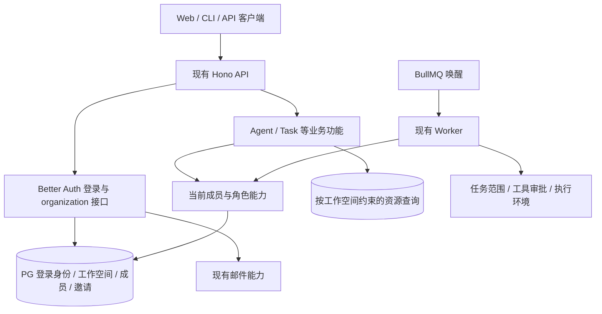

# 工作空间、成员与授权方案

日期：2026-11-15。用户已确认采用 Better Auth。本文是接入方案，团队业务尚未实现；前端继续留待后续。依据见 [官方实践与 LobeHub 调研](research/teams-and-authorization.md)，选型见 [ADR-0005](adr/0005-workspace-authorization.md)。

## 采用官方流程的原则

以当前稳定版 Better Auth 的公开配置、organization 插件和 Drizzle adapter 为基础。组织创建、成员、邀请、角色修改和删除使用 SDK 公开接口；调整产品行为时优先采用公开配置和 hooks。官方 [Hooks 文档](https://www.better-auth.com/docs/concepts/hooks) 明确建议通过 hooks 调整既有端点。

保留 SDK 的创建接口和成员流程。隔离测试只说明其特定配置下的行为，不能单独证明实际 Drizzle/PG 部署需要自定义创建流程或数据库触发器；这类改动须先有相同配置下的复现、产品约束和上游方案评估。尚待核实的问题保留为接入验证项。

参考官方维护的 [organization-best-practices](https://github.com/better-auth/skills/blob/20c9e88a5c007461a703f1c213572b073196113e/better-auth/organization/SKILL.md) 组织接入流程；API 签名、返回字段和钩子名称以同版本文档、公开类型及官方测试为准。指南中的概略示例不直接复制为生产实现。

## 首轮业务范围

实现创建和列出工作空间、修改基本资料、成员列表、邮箱邀请与接受/拒绝/取消、角色修改、退出及移除成员，并验证每个入口的服务端授权。先贯通真实 PG 下的后端链路，登录和邀请页面后续实现。

产品统一使用 Workspace 表达人类协作空间，SDK 的 Organization 对应同一实体。一个用户可以加入多个空间，角色互相独立；只有一个成员的空间也可用于个人工作。任务的本地工作目录、多个 Agent 的协作组分别属于执行与 Agent 功能。

不再增加 Organization → Workspace → Team 多层结构。组织下属 Teams、动态角色编辑器和额外权限服务当前关闭。账户创建与创建空间保持两个显式流程；首轮无需在注册钩子中自动建空间。

## 架构与职责



| 所有者 | 负责的知识 |
| --- | --- |
| authentication | 登录会话、SDK HTTP 接入与后台工作的生命周期 |
| workspaces | organization 插件配置、角色定义、邀请邮件与确有需求的产品钩子 |
| 各业务功能 | 具体资源的归属、可见性、允许的操作与事务 |
| tasks / 执行入口 | 任务授权、实际操作前复核、工具审批与暂停恢复 |
| infrastructure/database | 连接、SDK schema 和存储映射 |
| bootstrap | 绑定数据库、插件与邮件能力 |

这些职责共用现有 API/Worker，不增加进程。功能之间通过必要身份与能力交接，不传递完整 auth 对象、SDK session 或全量启动配置。

## 三种授权

| 问题 | 落点 | 示例 |
| --- | --- | --- |
| 成员具有哪些操作能力 | organization 的角色与 permission statements | 邀请成员、修改空间资料、创建 Agent |
| 能否操作这个具体资源 | 资源功能的判定与受约束的 SQL | 资源属于哪个空间、是否私有、是否允许该成员使用 |
| Agent 能否执行这一次操作 | 任务和真实执行入口 | shell、发信、访问设备、需要人工批准的调用 |

Owner 角色不自动赋予别人的私有内容、个人电脑或全部工具的访问权。Router 的判断、队列派发、切换执行器与沙箱启动均不扩大任务授权。Claude 的 Permissions 与 DSH 的任务授权范围在执行层保留，不用团队角色替代。

平台可以限制谁能向哪个设备派发；本地 Agent 内部工具的实际限制依赖其公开审批协议和主机权限。云端则由工具授权和沙箱限制共同实施。仅展示执行事件不能替代这些约束。

## 角色与官方配置

采用 SDK 默认的 owner/admin/member，并按官方自定义角色方式增加只读 viewer。`createAccessControl` 的 statements 与角色定义只维护一份，自定义既有角色时明确合并 SDK 默认组织管理权限。

| 角色 | 首版含义 |
| --- | --- |
| Owner | 空间管理、成员和邀请、删除与 Owner 身份管理 |
| Admin | 空间资料、成员和邀请管理；不能修改 Owner 或删除空间 |
| Member | 普通成员；业务资源能力随具体功能定义 |
| Viewer | 读取允许可见的内容；不创建任务、不调用模型或执行工具 |

界面可以先提供单角色选择。SDK 支持多个角色，后端沿用其角色组合与检查语义，不自行按名称排优先级，也不添加与 SDK 的角色存储格式冲突的单值 SQL 约束。

沿用 SDK 的多 Owner 模型及最后一个 Owner 保护；移交时先赋予另一位成员 Owner，再由原 Owner 退出或降权。目前不引入与账单绑定的 primaryOwnerId。并发场景仍需在实际 PG 配置下验证，不能把官方的常规流程保护扩大描述为所有交错下的数据库不变量。

| 配置 | 接入建议 |
| --- | --- |
| organization | 与现有登录共用一个 auth 实例 |
| roles / ac | 默认管理权限加 viewer，新增实际业务操作时再扩充 |
| teams | 关闭，当前只有一层协作空间 |
| dynamicAccessControl | 关闭，不创建动态角色表和编辑流程 |
| allowUserToCreateOrganization | 使用官方回调要求创建者邮箱已验证 |
| requireEmailVerificationOnInvitation | 显式启用 |
| invitationExpiresIn | 明确配置七天，邮件文案读取相同常量 |
| sendInvitationEmail | 注入现有邮件能力，集中格式与链接构造 |
| 请求目标空间 | 业务操作明确指定 organizationId / workspaceId |

来源：[Organization 文档](https://www.better-auth.com/docs/plugins/organization)。限制值属于产品配置；不新增决定谁是 Owner 的环境变量。

## 数据库与迁移

继续使用现有 PostgreSQL、Drizzle 和 `drizzleAdapter({ provider: 'pg', transaction: true })` 配置。SDK 事务支持按其实际调用范围工作；不声称开关能把整个 HTTP 请求及外部邮件都变成一个事务。

按官方插件配置运行 schema generate，将生成结果与现有认证 schema 对照，再通过仓库已有 Drizzle 迁移流程提交和应用。Drizzle adapter 使用 schema 生成加 ORM 迁移；不使用仅适用于内置 Kysely adapter 的 auth migrate 路径。

预计增加 organization、member、invitation 三个模型，以及登录会话的 activeOrganizationId；关闭的 Teams 和动态角色不增加对应模型。字段、索引和关系以生成结果及公开 schema 为准。SQL 表名可映射为 workspaces、workspace_members、workspace_invitations，仍只保存一组事实。

已有用户、账号、会话与验证记录不重新生成覆盖。SDK 的对象字段遵循公开命名，数据库列名按现有约定映射；不在业务模块复制一套成员或角色记录。

activeOrganizationId 表达选择状态。受保护操作仍核验当前 membership，并在业务查询中约束目标空间；不能因为 session 中保留这个 ID 就视为已授权。多标签使用不同空间时，显式空间参数避免相互覆盖。

来源：[Drizzle adapter](https://www.better-auth.com/docs/adapters/drizzle)、[数据库与插件 schema](https://www.better-auth.com/docs/concepts/database)。

## 接口与扩展点

所有组织管理接口使用现有 `/api/auth/organization/*`，沿用 SDK 的会话、来源检查、CSRF 检查与权限检查，以及当前 Hono 接入的限流、请求体大小和 no-store 设置。

用户请求按官方 server API 方式传入其请求 headers；不把请求体中的 userId 当作已认证的发起人。仅供可信服务器调用的 addMember 等能力不直接转成接受任意 userId 的客户端入口。团队管理员使用 organization 的 admin 角色，不因此启用平台用户管理的 admin 插件。

| 能力 | SDK 路径，相对 /api/auth |
| --- | --- |
| 创建与列出空间 | POST /organization/create；GET /organization/list |
| 基本资料 | GET /organization/get-organization；POST /organization/update |
| 成员列表与角色修改 | GET /organization/list-members；POST /organization/update-member-role |
| 邮箱邀请及重发 | POST /organization/invite-member |
| 接受、拒绝和取消 | POST /organization/accept-invitation、reject-invitation、cancel-invitation |
| 移除、退出和删除 | POST /organization/remove-member、leave、delete |
| 当前角色能力 | POST /organization/has-permission |

不为这些方法再建立逐项转发的 REST 镜像。只有具体业务聚合或流程提出独立职责后，才增加应用接口；自有 Cookie 写入接口必须自己落实来源/CSRF 和资源授权，SDK 配置不会自动保护其他 Hono 路由。

hooks 用于已明确的产品校验、字段补充或通知。可预期拒绝使用公开 APIError；输入校验放在相应创建前阶段，避免不必要地延迟到初始成员写入。网络投递由专门邮件回调负责，不把外部副作用当作数据库提交的一部分。

`hasPermission` 的 HTTP 200 不等于允许操作，应检查响应的 success。前端 `checkRolePermission` 仅用于静态展示；动态角色若以后启用，按官方说明使用服务端 hasPermission。具体资源仍须检查自己的身份、归属与可见性。

## 邀请与邮件

邀请由组织授权产生，按 SDK 的状态、有效期、邮箱匹配和取消流程处理。收件人登录并验证邮箱后，POST 接受。默认沿用 SDK 的邀请有效性语义：邀请者离开不自动等于撤销所有已发邀请；有权限的管理者可以取消。若以后明确要求离任即撤销，再通过公开生命周期钩子实现该产品规则，不先把默认行为判为缺陷。

当前还没有邀请落地页，先用 API 与内存收件箱验收，不发送指向未实现页面的正式邀请。接前端时一并完成登录后返回、邀请展示、接受按钮、过期/取消/已加入状态和真实邮件验证。GET 打开页面，POST 才执行接受。

复用 Resend 与当前受管理的后台工作，不单独增加邮件框架。创建邀请成功与邮件送达分别描述；目前进程内投递允许重发，不提供跨崩溃投递保证。后续已有持久 Outbox 时统一接入。

Resend 测试发件人暂时只覆盖账号绑定邮箱；正式对外邀请需要自己的已验证发信域名。中英文展示与邮件文案使用对应文案资源；wire 角色值保持稳定。

## 资源、撤权与 Worker

Agent、Session、文件等资源落地时使用明确的 workspaceId，查询、列表、批量操作和导出均约束归属。SDK 的角色能力检查不自动为 Drizzle 查询添加条件。

建议个人创建的 Agent、Session、文档默认私有，共享需要明确动作；这属于我们的产品政策，不是 SDK 自动提供的行为。其他成员加入不会自动发布旧的私有内容。资源的查看、使用、编辑、删除和管理授权分别解释，避免“能用 Agent 就能修改配置”。

首版从 PG 读取当前成员和角色，不缓存跨请求的授权结果。移除或降权后，后续请求重新检查；已经在途的请求或外部副作用不承诺自动撤回。

Worker 依据持久任务中的执行主体，在执行前使用当前成员事实和同一套公开权限定义判定；不模拟用户 Cookie，不因请求来自内部就放行。发起者退出后的任务暂停、设备撤权、长连接与事件重放的处理随相应功能落地。

后续删除工作空间还需通过任务停止与沙箱释放流程，数据库级联不承担停止外部计算的职责。当前不预建通用 ACL 总表、策略解释器或完整审计系统。

## 接入验证与证据范围

已阅读官方组织插件的角色、Owner 保护、邀请、字段返回及级联回滚测试，和组织在数据库 hooks 中创建的测试。使用本仓库匹配版本复核，而不是把旧版本 Issue 或机器人回复当作现行规则。

现有 `tests/sdk/better-auth-organization.test.ts` 使用官方公开测试工具，但后端是内存 SQLite/Kysely，包含测试散列、注入钩子失败和并发屏障。这些是版本行为探针，不是 Drizzle/PG 的生产保证，也不是我们希望长期维持的错误行为。

| 类别 | 下一步验证 |
| --- | --- |
| 配置与迁移 | 官方生成 schema 对照、实际列/索引与 adapter 配置一致 |
| 常规组织流程 | 官方创建、列表、资料修改、退出与删除，使用 SDK 的原有入口 |
| 权限 | 四种角色、SDK 多角色组合、无成员身份、跨空间参数、success=false 的拒绝语义 |
| 邀请 | 邮箱验证、邮箱匹配、重发、过期、取消、重复与并发接受 |
| 事务与失败 | 在真实 Drizzle/PG 上检查创建及初始成员失败、邀请状态与成员提交、级联失败回滚 |
| Owner | 常规最后 Owner 保护、并发退出/降权，并与同版本官方测试比较 |
| 回归 | Google/GitHub/邮箱登录、会话撤销、当前用户与限流继续通过 |

若实际配置下仍有影响产品所需保证的问题，先检索同版本上游修复与公开扩展方案，形成最小复现和明确需求，再决定处理。当前不预定 SQL 触发器、不禁用 SDK 创建入口，也不自行复刻组织事务。尚未验证的问题不会写成已解决。

## 目录与实施顺序

初次接入只为实际职责创建文件：

```text
apps/server/src/workspaces/
  index.ts                 # 具名公开入口
  organization.ts          # 插件配置与邀请邮件绑定
  permissions.ts           # 一份角色与能力定义
apps/server/src/infrastructure/database/
  workspace-schema.ts      # 经官方生成结果核对的存储映射
```

需要业务成员解析入口时再在 workspaces 中增加相应实现。纯规则测试相邻；第三方 SDK 行为测试在 tests/sdk，跨应用真实链路在 tests/integration，不机械地为每个 SDK 方法新建函数或文件。

实施顺序：锁定稳定版并生成 schema → 接入官方 organization 配置和默认流程 → 验证实际 PG/Drizzle 的角色、邀请及失败语义 → 再接 Agent 的最小业务链路。前端与真实邀请投递在允许接前端后一起完成。

本阶段不需要新的密钥，继续使用现有 BETTER_AUTH_SECRET、BETTER_AUTH_URL、RESEND_API_KEY 与 EMAIL_FROM。角色和成员是产品事实，部署 env 不授予业务身份。
