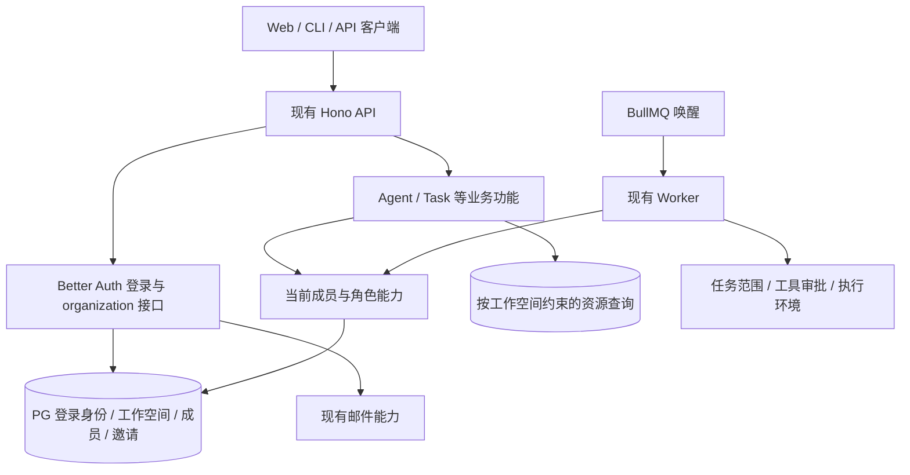

# 工作空间、成员与授权方案

日期：2026-11-15。Workspace 后端已接入 Better Auth 1.7.24；前端尚未实现。本文说明接口、角色、数据归属与实际验证边界。依据见 [官方实践与 LobeHub 调研](research/teams-and-authorization.md)，选型见 [ADR-0005](adr/0005-workspace-authorization.md)。

## 采用官方流程的原则

以当前稳定版 Better Auth 的公开配置、organization 插件和 Drizzle adapter 为基础。组织创建、成员、邀请、角色修改和删除使用 SDK 公开接口；调整产品行为时优先采用公开配置和 hooks。官方 [Hooks 文档](https://www.better-auth.com/docs/concepts/hooks) 明确建议通过 hooks 调整既有端点。

保留 SDK 的创建接口和成员流程。先在实际 Drizzle/PG 配置下复现一致性问题，再通过版本补丁修正 SDK 的事务边界；补丁范围与删除条件见下文。组织、成员及角色仍只有 SDK 管理的一组事实。

参考官方维护的 [organization-best-practices](https://github.com/better-auth/skills/blob/20c9e88a5c007461a703f1c213572b073196113e/better-auth/organization/SKILL.md) 组织接入流程；API 签名、返回字段和钩子名称以同版本文档、公开类型及官方测试为准。指南中的概略示例不直接复制为生产实现。

## 首轮业务范围

已实现创建和列出工作空间、修改基本资料、成员列表、邮箱邀请与接受/拒绝/取消/重发、角色修改、退出、移除成员及删除空间，真实 PG 测试覆盖服务端授权。登录和邀请页面后续实现。

产品统一使用 Workspace 表达人类协作空间，SDK 的 Organization 对应同一实体。一个用户可以加入多个空间，角色互相独立；只有一个成员的空间也可用于个人工作。任务的本地工作目录、多个 Agent 的协作组分别属于执行与 Agent 功能。

不再增加 Organization → Workspace → Team 多层结构。组织下属 Teams、动态角色编辑器和额外权限服务当前关闭。账户创建与创建空间保持两个显式流程；首轮无需在注册钩子中自动建空间。

## 架构与职责



| 所有者 | 负责的知识 |
| --- | --- |
| authentication | 登录会话、SDK HTTP 接入与后台工作的生命周期 |
| workspaces | organization 插件配置、角色定义、邀请邮件与确有需求的产品钩子 |
| 各业务功能 | 具体资源的归属、可见性、允许的操作与事务 |
| tasks / 执行入口 | 任务授权、实际操作前复核、工具审批与暂停恢复 |
| infrastructure/database | 连接、SDK schema 和存储映射 |
| bootstrap | 绑定数据库、插件与邮件能力 |

这些职责共用现有 API/Worker，不增加进程。功能之间通过必要身份与能力交接，不传递完整 auth 对象、SDK session 或全量启动配置。

## 三种授权

| 问题 | 落点 | 示例 |
| --- | --- | --- |
| 成员具有哪些操作能力 | organization 的角色与 permission statements | 邀请成员、修改空间资料、创建 Agent |
| 能否操作这个具体资源 | 资源功能的判定与受约束的 SQL | 资源属于哪个空间、是否私有、是否允许该成员使用 |
| Agent 能否执行这一次操作 | 任务和真实执行入口 | shell、发信、访问设备、需要人工批准的调用 |

Owner 角色不自动赋予别人的私有内容、个人电脑或全部工具的访问权。Router 的判断、队列派发、切换执行器与沙箱启动均不扩大任务授权。Claude 的 Permissions 与 DSH 的任务授权范围在执行层保留，不用团队角色替代。

平台可以限制谁能向哪个设备派发；本地 Agent 内部工具的实际限制依赖其公开审批协议和主机权限。云端则由工具授权和沙箱限制共同实施。仅展示执行事件不能替代这些约束。

## 角色与官方配置

直接复用 SDK 的 owner/admin/member 权限对象，并通过其 `defaultAc.newRole({})` 增加只读 viewer。角色定义只维护一份；具体业务资源落地后再扩充 statements，同时保留默认组织管理权限。

| 角色 | 首版含义 |
| --- | --- |
| Owner | 空间管理、成员和邀请、删除与 Owner 身份管理 |
| Admin | 空间资料、成员和邀请管理；不能修改 Owner 或删除空间 |
| Member | 普通成员；业务资源能力随具体功能定义 |
| Viewer | 读取允许可见的内容；不创建任务、不调用模型或执行工具 |

界面可以先提供单角色选择。SDK 支持多个角色，后端沿用其角色组合与检查语义，不自行按名称排优先级，也不添加与 SDK 的角色存储格式冲突的单值 SQL 约束。

沿用 SDK 的多 Owner 模型及最后一个 Owner 保护；移交时先赋予另一位成员 Owner，再由原 Owner 退出或降权。目前不引入与账单绑定的 primaryOwnerId。版本补丁保证通过当前管理接口执行的 Owner 检查与变更在同一空间内串行化；这不是任意直接 SQL 写入均受约束的数据库不变量。

| 配置 | 接入建议 |
| --- | --- |
| organization | 与现有登录共用一个 auth 实例 |
| roles / ac | 默认管理权限加 viewer，新增实际业务操作时再扩充 |
| teams | 关闭，当前只有一层协作空间 |
| dynamicAccessControl | 关闭，不创建动态角色表和编辑流程 |
| allowUserToCreateOrganization | 使用官方回调要求创建者邮箱已验证 |
| requireEmailVerificationOnInvitation | 显式启用 |
| invitationExpiresIn | 明确配置七天，邮件文案读取相同常量 |
| sendInvitationEmail | 注入现有邮件能力，集中格式与链接构造 |
| 请求目标空间 | 业务操作明确指定 organizationId / workspaceId |

来源：[Organization 文档](https://www.better-auth.com/docs/plugins/organization)。限制值属于产品配置；不新增决定谁是 Owner 的环境变量。

## 数据库与迁移

继续使用现有 PostgreSQL、Drizzle 和 `drizzleAdapter({ provider: 'pg', transaction: true })` 配置。SDK 事务支持按其实际调用范围工作；不声称开关能把整个 HTTP 请求及外部邮件都变成一个事务。

已通过官方 `auth@1.7.24 generate --adapter drizzle --dialect postgresql` 按实际插件配置核对新增模型，再通过已有 Drizzle 流程生成和应用 `0002_workspaces.sql`。Drizzle adapter 使用 schema 生成加 ORM 迁移；不使用仅适用于内置 Kysely adapter 的 auth migrate 路径。

新增 organization、member、invitation 三个模型，以及登录会话的 activeOrganizationId；关闭的 Teams 和动态角色没有对应模型。SQL 表名映射为 workspaces、workspace_members、workspace_invitations，organizationId 和 activeOrganizationId 分别映射为 workspace_id 和 active_workspace_id；SDK wire 字段保持原名。

已有用户、账号、会话与验证记录不重新生成覆盖。SDK 的对象字段遵循公开命名，数据库列名按现有约定映射；不在业务模块复制一套成员或角色记录。

activeOrganizationId 表达选择状态。受保护操作仍核验当前 membership，并在业务查询中约束目标空间；不能因为 session 中保留这个 ID 就视为已授权。多标签使用不同空间时，显式空间参数避免相互覆盖。

来源：[Drizzle adapter](https://www.better-auth.com/docs/adapters/drizzle)、[数据库与插件 schema](https://www.better-auth.com/docs/concepts/database)。

## 接口与扩展点

所有组织管理接口使用现有 `/api/auth/organization/*`，沿用 SDK 的会话、来源检查、CSRF 检查与权限检查，以及当前 Hono 接入的限流、请求体大小和 no-store 设置。

用户请求按官方 server API 方式传入其请求 headers；不把请求体中的 userId 当作已认证的发起人。仅供可信服务器调用的 addMember 等能力不直接转成接受任意 userId 的客户端入口。团队管理员使用 organization 的 admin 角色，不因此启用平台用户管理的 admin 插件。

| 能力 | SDK 路径，相对 /api/auth |
| --- | --- |
| 创建与列出空间 | POST /organization/create；GET /organization/list |
| 基本资料 | GET /organization/get-organization；POST /organization/update |
| 成员列表与角色修改 | GET /organization/list-members；POST /organization/update-member-role |
| 邮箱邀请及重发 | POST /organization/invite-member |
| 接受、拒绝和取消 | POST /organization/accept-invitation、reject-invitation、cancel-invitation |
| 移除、退出和删除 | POST /organization/remove-member、leave、delete |
| 当前角色能力 | POST /organization/has-permission |

不为这些方法再建立逐项转发的 REST 镜像。只有具体业务聚合或流程提出独立职责后，才增加应用接口；自有 Cookie 写入接口必须自己落实来源/CSRF 和资源授权，SDK 配置不会自动保护其他 Hono 路由。

hooks 用于已明确的产品校验、字段补充或通知。可预期拒绝使用公开 APIError；输入校验放在相应创建前阶段，避免不必要地延迟到初始成员写入。网络投递由专门邮件回调负责，不把外部副作用当作数据库提交的一部分。

`hasPermission` 的 HTTP 200 不等于允许操作，应检查响应的 success。前端 `checkRolePermission` 仅用于静态展示；动态角色若以后启用，按官方说明使用服务端 hasPermission。具体资源仍须检查自己的身份、归属与可见性。

## 邀请与邮件

邀请由组织授权产生，按 SDK 的状态、有效期、邮箱匹配和取消流程处理。收件人登录并验证邮箱后，POST 接受。默认沿用 SDK 的邀请有效性语义：邀请者离开不自动等于撤销所有已发邀请；有权限的管理者可以取消。若以后明确要求离任即撤销，再通过公开生命周期钩子实现该产品规则，不先把默认行为判为缺陷。

当前邀请邮件链接指向已实现的 SDK `GET /api/auth/organization/get-invitation?id=…`，需要以收件人身份登录并验证邮箱；GET 只读取详情，接受仍需显式 POST。没有额外邀请页面。接前端时再替换为页面链接，一并完成登录后返回、状态展示和真实邮件验证。

复用 Resend 与当前受管理的后台工作，不单独增加邮件框架。创建邀请成功与邮件送达分别描述；目前进程内投递允许重发，不提供跨崩溃投递保证。后续已有持久 Outbox 时统一接入。

未配置邮件发送器时，SDK 仍创建可通过 ID 接受的邀请，不声称已投递邮件。Resend 测试发件人暂时只覆盖账号绑定邮箱；正式对外邀请需要自己的已验证发信域名。当前服务端邮件与认证邮件统一为英文纯文本；接前端语言选择时再接邮件语言资源，wire 角色值保持稳定。

## 资源、撤权与 Worker

Agent、Session、文件等资源落地时使用明确的 workspaceId，查询、列表、批量操作和导出均约束归属。SDK 的角色能力检查不自动为 Drizzle 查询添加条件。

建议个人创建的 Agent、Session、文档默认私有，共享需要明确动作；这属于我们的产品政策，不是 SDK 自动提供的行为。其他成员加入不会自动发布旧的私有内容。资源的查看、使用、编辑、删除和管理授权分别解释，避免“能用 Agent 就能修改配置”。

Agent 生命周期已加入实际 statements：Member 的 update 只能结合创建者身份管理自己的定义；Owner/Admin 的 manage 可结合 Workspace 可见性管理共享定义。私人定义不开放管理员越权。Session 的命名、归档、取消和删除始终要求本人归属与当前 Workspace 写权限，Viewer 只读；停用 Agent 不取消这些会话管理权。删除与资源回收语义见 [ADR-0003](adr/0003-agent-session-lifecycle.md)。

首版从 PG 读取当前成员和角色，不缓存跨请求的授权结果。移除或降权后，后续请求重新检查；已经在途的请求或外部副作用不承诺自动撤回。

Worker 依据持久任务中的执行主体，在执行前使用当前成员事实和同一套公开权限定义判定；不模拟用户 Cookie，不因请求来自内部就放行。发起者退出后的任务暂停、设备撤权、长连接与事件重放的处理随相应功能落地。

当前有 Agent 的 Workspace 删除返回 409，需先回收其 Session，再删除空 Agent 定义。创建 Agent 在同一事务内先对 Workspace 取共享行锁，再读取并锁定成员权限，与 SDK 的删除锁顺序一致：创建先完成时删除返回业务冲突，删除先完成时创建返回资源不可用。数据库级联不承担停止外部计算的职责。当前不预建通用 ACL 总表、策略解释器或完整审计系统。

Workspace 删除钩子使用 SDK 正在持有的 PG 事务查询 Agent。成员退出后，Owner/Admin 可显式提交 [退组回收](cloud-agent.md#编辑归档与资源回收)。管理员获得清理权限，私人 Agent 和会话内容继续限本人访问。

## 接入验证与证据范围

已阅读官方组织插件的角色、Owner 保护、邀请、字段返回及级联回滚测试，和组织在数据库 hooks 中创建的测试。使用本仓库匹配版本复核，而不是把旧版本 Issue 或机器人回复当作现行规则。

`tests/integration/workspaces.test.ts` 通过真实 Hono、认证实例、PG、Redis 和内存邮箱验证业务流程。测试用户实际注册、验证邮箱、登录，再通过公开邀请入口加入空间，不直接插入成员。`tests/sdk/better-auth-organization.pg.test.ts` 采用官方测试工具、测试散列和实际 Drizzle/PG adapter，专门保护补丁的故障与锁边界；没有访问真实邮件服务。

| 类别 | 已验证 |
| --- | --- |
| 配置与迁移 | 官方生成 schema 对照、实际列/索引与 adapter 配置一致 |
| 常规组织流程 | 官方创建、列表、资料修改、退出与删除，使用 SDK 的原有入口 |
| 权限 | 四种角色、SDK 多角色组合、无成员身份、跨空间参数、success=false 的拒绝语义 |
| 邀请 | 邮箱验证、邮箱匹配、重发、过期、取消、重复与并发接受 |
| 事务与失败 | 在真实 Drizzle/PG 上检查创建及初始成员失败、邀请状态与成员提交、级联失败回滚 |
| Owner | 常规最后 Owner 保护、并发互相移除、并发退出及降权；PG 锁等待探针验证真实串行化 |
| 回归 | Google/GitHub/邮箱登录、会话撤销、当前用户与限流继续通过 |

SDK 探针纳入 `pnpm test:integration` 与现有 CI；普通 `pnpm test` 无需数据库。之前的 SQLite 组织探针已由 PG 回归替换，避免同时维护重复且证据范围不同的测试。

## 版本补丁与升级

未修改的 1.7.24 在相同 Drizzle/PG 配置下复现以下问题：初始成员钩子失败会留下空空间；两个 Owner 在计数后并发互相移除可留下零成员；并发创建的不同邀请可以为同一用户建立重复成员，或让不同用户突破人数上限。官方公开 hooks 不能将这些既有路由的检查和写入包进同一事务，现有版本也没有对应开关。

`patches/better-auth@1.7.24.patch` 因此只修正 SDK 内部的事务范围和锁顺序：

- 创建组织及首位成员共用 SDK 的 `runWithTransaction`；创建前后钩子失败一并回滚。
- 移除、角色变更、退出及删除先在事务中对组织执行同值 ID 更新，获取 PG 行锁；随后重新读取成员、角色和 Owner 数量，再执行原有 SDK 校验与写入。
- Owner 数量查询使用当前事务 adapter，删除也遵守相同锁顺序。SDK 自有的成员及级联事务加入外层事务。
- 接受不同邀请时，在原有成员事务中按组织加锁并重新检查已有成员，重复加入返回 USER_IS_ALREADY_A_MEMBER_OF_THIS_ORGANIZATION；原有成员人数上限检查也移入该事务锁内；数据库唯一索引约束 Workspace/User 组合，移除重复的单列 Workspace 索引。

这保留公开接口、默认角色和错误协议，没有自定义创建接口、补偿删除流程或 SQL 触发器。锁作用于 PG 中的空间行，能够协调多个 API 进程。当前保证针对本仓库的 PG、真实事务和默认 READ COMMITTED 隔离；不推导到禁用事务的 adapter、任意数据库或直接 SQL 管理操作。事务中 hooks 不应承担不可撤销的外部副作用。

新增成员唯一性迁移不自动删除或合并历史重复数据，若现存数据违反约束则迁移明确失败。真实 SDK 回归同时接受两条不同邀请，验证只有一条成员记录且另一请求得到业务拒绝；本轮证据见 [审查记录](reviews/cloud-agent-2026-11-15.md)。

pnpm 按精确版本应用补丁，源码、锁文件及回归一起提交。升级 Better Auth 时先比较上游相关实现；修复已上游化且 PG 回归通过后，删除补丁及 `patchedDependencies`，继续保留行为回归。需要修改锁机制时同时审查所有 Owner 变更和删除入口，不能只修一个路由。

邀请的 pending→accepted 条件领取与成员事务仍是 SDK 的两阶段实现；可捕获成员写入失败会恢复 pending，已验证回滚，但未提供进程在领取后崩溃时的自动恢复保证。进程内邮件投递同样没有跨崩溃保证。这些需要后续持久任务与 Outbox 明确恢复规则，当前不伪装成完整的可靠执行系统。

## 目录与实施顺序

初次接入只为实际职责创建文件：

```text
apps/server/src/workspaces/
  index.ts                 # 具名公开入口
  organization.ts          # 插件配置与邀请邮件绑定
  permissions.ts           # 一份角色与能力定义
apps/server/src/infrastructure/database/
  workspace-schema.ts      # 经官方生成结果核对的存储映射
```

需要业务成员解析入口时再在 workspaces 中增加相应实现。纯规则测试相邻；第三方 SDK 行为测试在 tests/sdk，跨应用真实链路在 tests/integration，不机械地为每个 SDK 方法新建函数或文件。

Workspace 后端已完成 schema/迁移、官方接口接入和真实 PG/Redis 验收，并已接入 Agent、Session 和云端执行链路。登录与 Workspace 前端尚未实现；当前邀请测试使用内存邮箱，真实邀请投递尚未联调。
本阶段不需要新的密钥，继续使用现有 BETTER_AUTH_SECRET、BETTER_AUTH_URL、RESEND_API_KEY 与 EMAIL_FROM。角色和成员是产品事实，部署 env 不授予业务身份。
